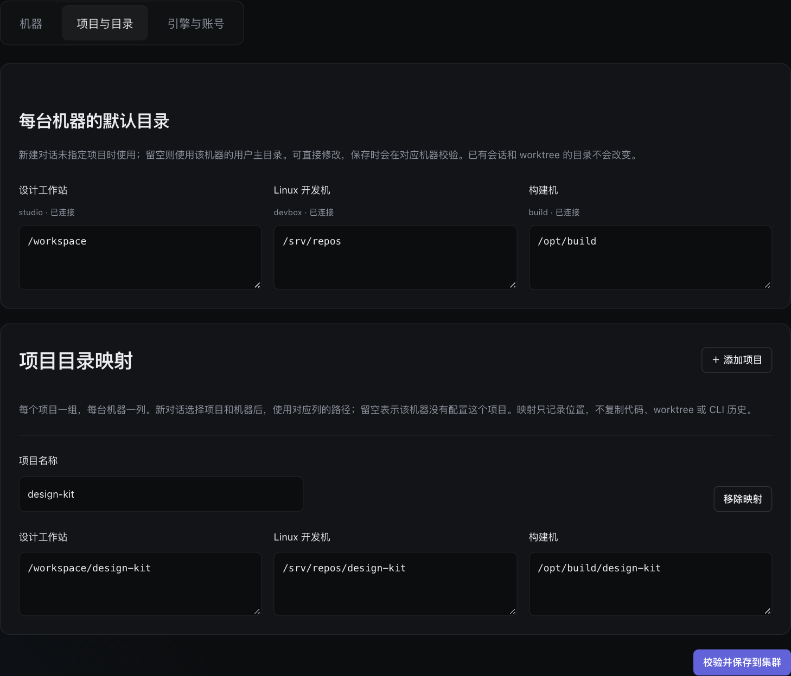
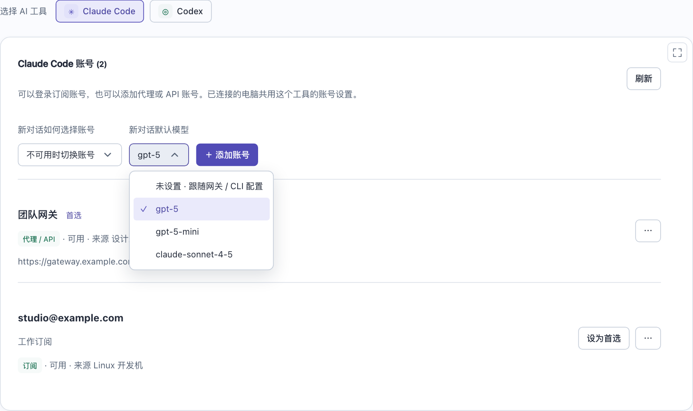

#  my-agents

Start a conversation in the Codex or Claude Code terminal, pick it up in Feishu or Lark from your phone, then continue in your browser or the original terminal. Your questions, replies, and tool history stay in the same session. One panel can manage several machines, and its proxy lets you use different models with the same coding engine.

[中文](README.md) · [User guide (Chinese)](docs/user-guide.md)


*The animation shows a local preview of cards generated by the gateway. Panel screenshots use sample accounts, projects, and conversations.*

## Continue the same conversation in the terminal, chat, or browser

1. **Start in the terminal.** In your project directory, ask Codex or Claude Code, “Which product updates landed this week?” Each engine keeps its own sessions. Pick that same session when you change where you chat.
2. **Pick it up on your phone.** Send your Feishu bot `/sessions product updates`. Find the conversation by its machine, project, and last question, then select **切换到此会话**. Ask “Expand the second update for the design team.” The agent has the list you were discussing.
3. **Continue at your desk.** Open the same session under **Conversations** in the web panel. Your follow-up from Feishu and the reply are there, and you can keep editing. You can also continue in the original terminal. If you closed it, run `codex resume <session-id>` or `claude --resume <session-id>` in the project directory on the original machine.

To continue in a terminal window that is still open, the Codex daemon on that machine must have the session loaded, or the Claude Code window must allow incoming session messages. [Terminal handoff details (Chinese)](docs/user-guide.md)


## Try it in a chat

Send your bot a task like this:

> /new Read this week’s merged changes and write three updates I can share with the design team.

Choose a project and an engine, then submit. The task card updates as the agent works. Reply in the thread to ask for a revision. As the task author, open **详情与操作 → 生成分享卡** at the bottom of the finished task and forward the resulting card. The footer shows the engine and, when available, the model that answered. Click **my-agents** to open this repository.

## Start your first panel

With Node.js 18+ and npm, start the panel with:

```sh
npx --yes @wuchupeng/my-agents@latest
```

On a fresh Mac or Linux host with Git and curl, use the source installer:

```sh
curl -fsSL https://raw.githubusercontent.com/13days/my-agents/main/install.sh | sh
```

The installer uses your existing Node.js 18+ and npm when available. On Intel and ARM 64-bit systems it can download a checksum-verified Node.js 24 LTS runtime into your home directory. The source lives in `~/.local/share/my-agents/source`. The panel runs in the foreground. Use the same command to start it again.

1. Open **[localhost:4321](http://localhost:4321)**. Install and sign in to [Codex](https://developers.openai.com/codex/cli/) or [Claude Code](https://code.claude.com/docs/en/quickstart) on the machine that will run your task. Choose **Conversations → New chat**, pick a project, and ask how to run it.
2. Under **Chat apps**, scan the setup QR code or enter an existing bot’s credentials. Follow the pairing and card-button authorization prompts.
3. Send the bot the `/new` example above. You can follow its progress in the thread. [Feishu cards and commands (Chinese)](docs/feishu-interaction.md)

Under **Chat apps → Feishu → Access**, the group and direct-message rules appear side by side. In this example, the paired account can mention the bot in any group it has joined. Selecting the design group also grants its members access there.


<details>
<summary>Run a source checkout</summary>

```sh
git clone https://github.com/13days/my-agents.git
cd my-agents
npm install
MY_AGENTS_NO_PROXY_SETUP=1 npm start
```

Both the installer and this start command keep your terminal proxy configuration intact. For a persistent install, enable login startup in the macOS panel or install a Linux user service. [Installation and services (Chinese)](docs/agent-install.md)

</details>

## Run tasks on several machines from one panel

In **Devices & models → Machines → Add machine**, enter a passwordless SSH address or host alias. The panel prepares the runtime, installs the runner, and connects the device. Once it shows **Connected**, map the project’s path under **Projects & directories** and choose the device for your next conversation.



If SSH is unavailable but the device can reach the panel, open **Other ways to connect** and run the generated command on the device.

For example, open one conversation with Claude Code on your laptop to review the frontend and another with Codex on a Linux machine to run tests. Both report progress in the same panel.

In Feishu, send `/node` to list machines. If your development machine is named `devbox` and the project lives at `~/repos/web`, send `/node devbox ~/repos/web`, then ask it to run the tests in that thread. Commands run against the checkout on the selected machine.

An execution node is enough to run remote tasks. To keep receiving Feishu messages when your laptop goes offline, run three persistent full panels. The other two can form a majority and elect a new receiver. [Cluster setup and failover (Chinese)](docs/cluster-setup.md)

## Use different models in the same coding engine

Claude Code or Codex manages the conversation, files, and tools. Your account and proxy supply the model. For example, use a fast model for a routine edit, then choose a reasoning model in the same Feishu thread for a difficult bug.

1. In **Devices & models → Engines & accounts**, choose Claude Code or Codex and add a subscription or proxy account. Set **Default model for new sessions** from the available list. Each engine has its own default.
2. Send `/model` in a Feishu thread to choose the model for its next turn. Send `/model default` to restore the default. After a reply, open **详情与操作** to inspect the observed model and proxy. A fixed model mapping on the proxy can override the selection.
3. To use a Codex subscription from Claude Code, open the Claude Code subscription proxy configuration in the Codex account pool. Use it in a separate Claude configuration directory. Claude Code still runs tools on the selected machine, while the Codex subscription handles model requests. [Configuration and supported features (Chinese)](docs/codex-subscription-proxy.md)



## Let the assistant follow your chats

Connect your personal Feishu account under **Assistant**, choose which chats to read, and turn on sync. Review suggested actions based on senders, follow-up replies, and work already in progress. You can change the target conversations, approve an action, or dismiss it. Past reviews can inform future suggestions.


Model analysis has its own switch and daily budget. [Assistant settings (Chinese)](docs/heartflow.md)

[Issues](https://github.com/13days/my-agents/issues) · [MIT license](LICENSE)
