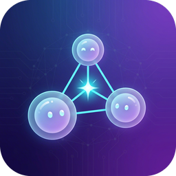
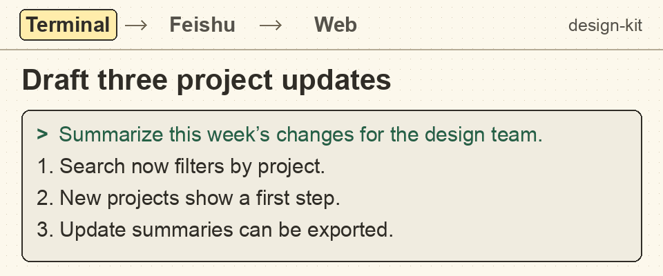
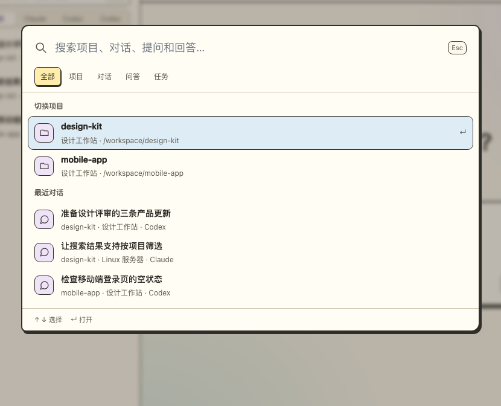
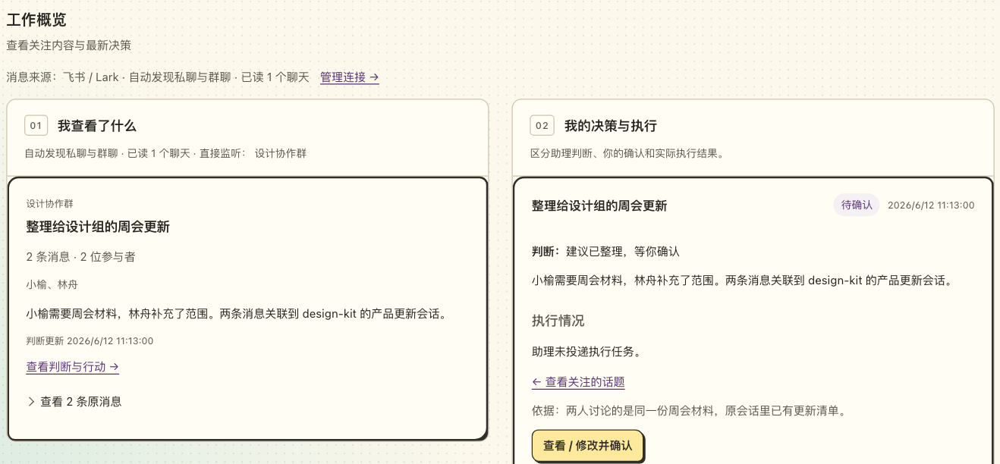
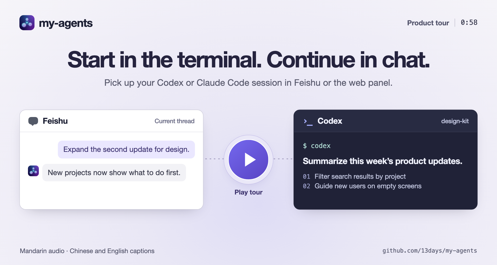

#  my-agents

**Start in Codex or Claude Code. Ask a follow-up in Feishu or WeCom. Open the web panel and the conversation is already there.**

my-agents is a self-hosted workspace for your coding agents. Use a Mac and a Linux server from one panel, choose where each task runs, and use a Codex subscription or a compatible model gateway with Claude Code. DeepSeek Harness is also available as an engine.

[中文](README.md) · [Connect a chat app](#connect-a-chat-app) · [Model accounts and proxies](#choose-the-engine-and-the-model-separately) · [Watch the full tour](#tour-and-guides)

## Quick start

On a **Mac or Linux machine with Git and curl**, run the installer. It checks for Node.js, installs it if needed, and starts the panel.

```sh
curl -fsSL https://raw.githubusercontent.com/13days/my-agents/main/install.sh | sh
```

1. On the computer where you want to work, install [Codex](https://developers.openai.com/codex/cli/) or [Claude Code](https://code.claude.com/docs/en/quickstart) and sign in, or configure your model gateway.
2. Open **[localhost:4321](http://localhost:4321)**, choose **Conversations → New conversation** and select an engine and a Git project. Ask “Summarize the last few commits in three bullets.” The reply appears in that conversation.
3. To continue on your phone, connect a chat app below. The clip follows one example project, `design-kit`, from a terminal draft to a follow-up about the second bullet.

[](https://cdn.jsdelivr.net/gh/13days/my-agents@c649f281ab28fba819469a0ad8400c5220aa55a1/docs/session-handoff.mp4)

*Play the 30-second clip with Chinese narration and English subtitles. The example uses the Sketchbook theme and a locally rendered Feishu card. Find Sketchbook under Appearance in the panel.*

### npm or remote access

- **Use npm.** With Node.js 18+ and npm, run `npx --yes @wuchupeng/my-agents@latest`. The screenshots on this page follow the GitHub main branch. [View the npm release](https://www.npmjs.com/package/@wuchupeng/my-agents)
- **Open a server from your laptop.** Run the command below on your laptop with your own SSH address in place of `user@server`. Then open localhost on port 4321. [Installation and startup services](docs/agent-install.md)

```sh
ssh -N -L 4321:127.0.0.1:4321 user@server
```

## Connect a chat app

### Feishu / Lark

1. In **Chat apps → Feishu**, scan the setup QR code or enter an existing app’s credentials. Follow the pairing instructions.
2. Send the bot `/sessions design-kit` in a DM, replacing `design-kit` with your project. Select **切换** (Switch) and ask “Can you give me an example for the second bullet?” Use `/new` to start a separate session.
3. To send a result to a colleague, open **Details & actions** on your completed card, generate a read-only share card and forward it. [Feishu commands and cards](docs/feishu-interaction.md) · [Share card preview](https://raw.githubusercontent.com/13days/my-agents/main/docs/feishu-share.gif)

### WeCom

1. Create an intelligent bot, choose **API mode → Long connection**, and enter its Bot ID and Secret in **Chat apps → WeCom**. When the panel shows **Connected**, the intended owner should send the first DM, `/whoami`.
2. To continue an existing **terminal or web** conversation, enable owner access to panel and terminal sessions in DMs on the setup page. Send `/sessions design-kit` to the bot, select the first result with `/use 1` and send your follow-up. In the default configuration, the bot lists your own sessions in the current chat.
3. For a new session, set the default machine, folder and engine on the same page. You can also choose a model and a separate Git worktree. Use `/status` to check progress. The bot accepts text, voice and quoted messages, and responds to mentions in groups. [WeCom setup and permissions](docs/im-channels.md)


### Back in the browser or terminal

Back at your desk, **⌘K** (or **Ctrl+K** on Windows and Linux) opens search. Switch projects, find an answer inside a conversation, or filter tasks by status. Press Enter to open a result. To resume from a terminal, run `codex resume <session-id>` or `claude --resume <session-id>` on the original machine. [Terminal handoff requirements](docs/user-guide.md)



## One panel for several machines

Have Claude Code review the frontend on your Mac while Codex runs tests on Linux. Each conversation has its own execution machine and project directory. Both report progress to the same panel.


- **Connect a machine.** Open **Computers & AI accounts → Computers**. Add a passwordless SSH host or alias to install the remote runner automatically. For password or MFA logins, sign in yourself and run the connection command shown in the panel.
- **Map the project.** Browse folders on each computer card. The same project can point to `~/src/design-kit` on the Mac and `/srv/repos/design-kit` on Linux. Each machine works in its own checkout.
- **Keep receiving messages.** macOS supports idle-sleep prevention and login startup. For reception when a laptop goes offline, deploy three full panels. Two online panels can elect a new message receiver. An existing CLI process stays on the machine that started it. [Project paths and worktrees](docs/execution-workspaces.md) · [Cluster setup and takeover](docs/cluster-setup.md)

## Choose the engine and the model separately

**You can use Claude Code’s tools with a GPT model.** Set up a model source under **Computers & AI accounts → AI accounts**. The engine runs commands and edits files on your computer. The account or gateway supplies the model.

| Model access you have | How to use it |
| --- | --- |
| A ChatGPT subscription that includes Codex | Sign in under **Codex**, then choose **Use Codex subscription proxy → Set up a Claude Code account**. One subscription can serve both Codex and Claude Code. |
| An Anthropic Messages-compatible gateway | Choose **Connect a custom proxy** under Claude Code, enter the gateway configuration and select an available model. DeepSeek Harness can reuse this proxy on machines with `dsh` installed. |

Set the default model for new conversations per engine. In a Feishu thread, use `/model` to select the model and `/route` to choose the account. If a gateway maps model names, check the observed model under **Details & actions** on the completed card. [Codex subscription proxy](docs/codex-subscription-proxy.md) · [DeepSeek Harness setup](docs/deepseek-harness.md)

## Let the assistant follow a conversation

Authorize your personal Feishu account under **Assistant** and select the chats to read. For example, a colleague can ask for a change in a group and clarify it later in a DM. The assistant considers the senders, follow-ups and existing tasks, then suggests which messages belong together and which session should receive them. Approve, change the destination or dismiss the suggestion. Reviews can inform later decisions.



Message sync and model analysis have separate switches. Model analysis also supports a daily budget. [Assistant access, review and budget](docs/heartflow.md)

## Tour and guides

[](https://cdn.jsdelivr.net/gh/13days/my-agents@c649f281ab28fba819469a0ad8400c5220aa55a1/docs/my-agents-intro.mp4)

**2 min 40 sec · Chinese narration · English and Chinese captions.** The tour follows a project from terminal to chat, then covers parallel tasks, model gateways and assistant approvals. [Download the MP4](https://raw.githubusercontent.com/13days/my-agents/c649f281ab28fba819469a0ad8400c5220aa55a1/docs/my-agents-intro.mp4) · [Download captions](docs/my-agents-intro.srt)

[User guide](docs/user-guide.md) · [Releases](https://github.com/13days/my-agents/releases) · [Report an issue](https://github.com/13days/my-agents/issues) · [MIT license](LICENSE)
