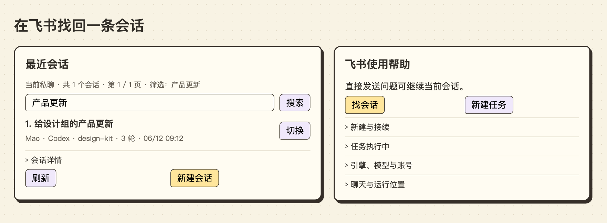
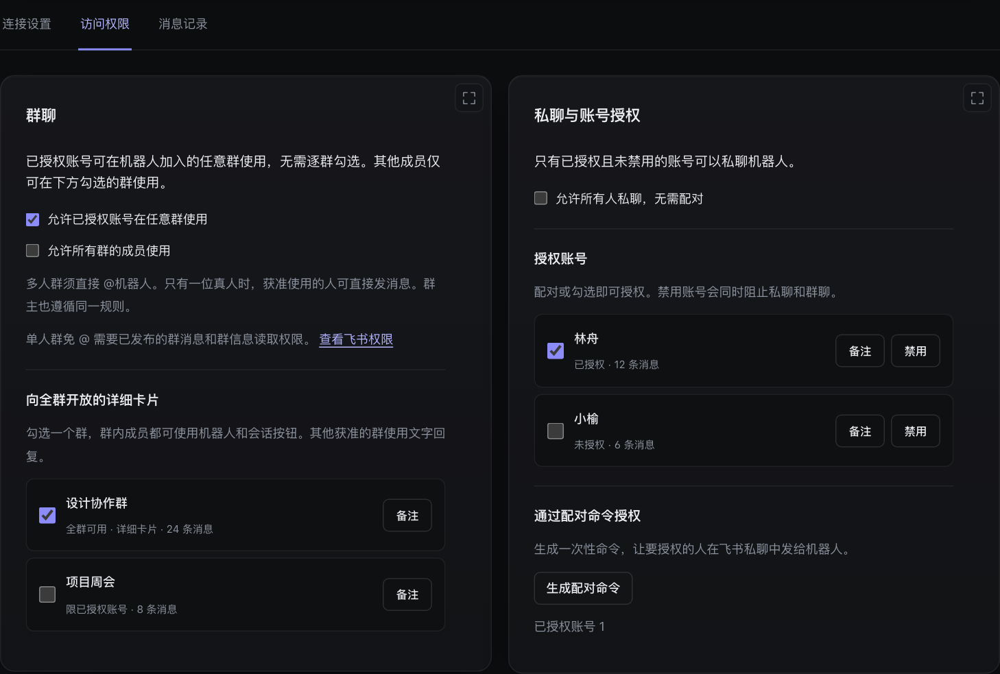
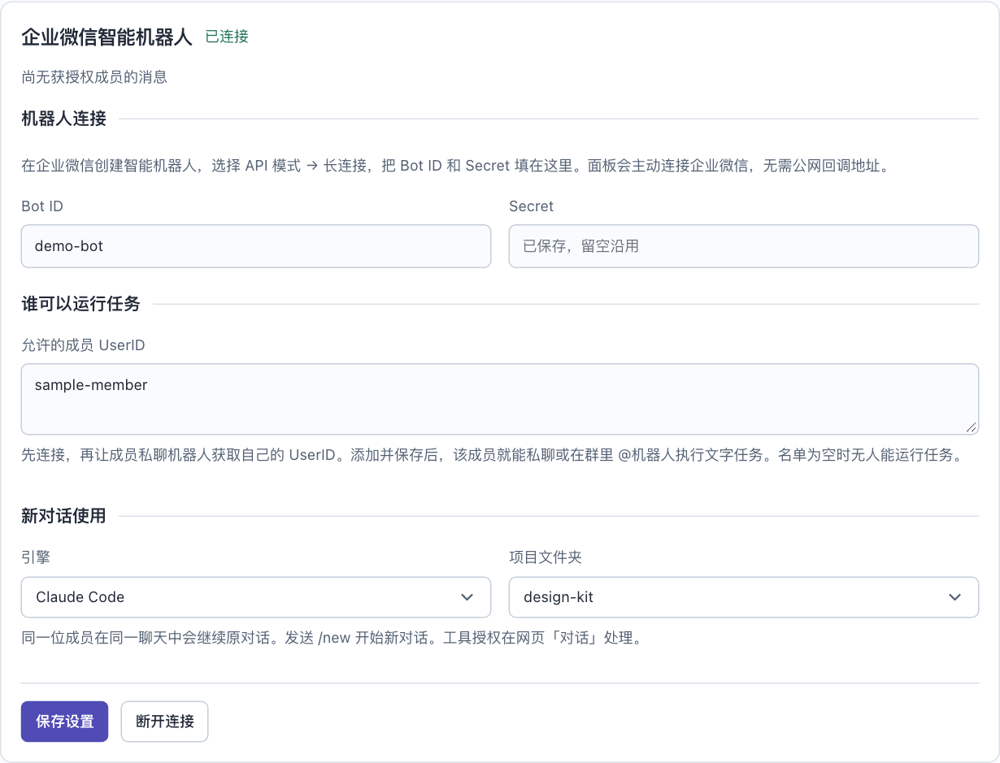

#  my-agents

**Start a Codex or Claude Code session in your terminal. Ask a follow-up in Feishu from your phone, then open the same conversation in your browser.**

On a Mac or Linux machine with Node.js 18+ and npm, run

```sh
npx --yes @wuchupeng/my-agents@latest
```

Open **[localhost:4321](http://localhost:4321)**, choose a CLI you’ve signed in to, and send your first message. To keep working with your laptop closed, run the panel and the session on an always-on Linux server. If the panel is on the server, run `ssh -L 4321:127.0.0.1:4321 user@server` on your own computer (use your SSH address), then open the link above.

[Connect Feishu](#try-it-in-a-chat) · [Connect WeCom](#send-tasks-from-wecom) · [Run on several machines](#run-tasks-on-several-machines-from-one-panel) · [User guide (Chinese)](docs/user-guide.md) · [中文](README.md)

[](https://github.com/13days/my-agents/releases/download/v0.18.0/my-agents-handoff.mp4)

[Play the 30-second demo with English subtitles](https://github.com/13days/my-agents/releases/download/v0.18.0/my-agents-handoff.mp4). The footage uses the example project design-kit.

## Continue the same conversation in the terminal, chat, or browser

1. **Start in the terminal.** In your project directory, ask Codex or Claude Code, “Which product updates landed this week?” Each engine keeps its own sessions. Pick that same session when you change where you chat.
2. **Pick it up on your phone.** Send your Feishu bot `/sessions product updates`. Find the conversation by its machine, project, and last question, then select **切换** (Switch) on the row. Expand **会话详情** for the branch and prompts, or send `/help` for Find session and New task. Ask “Expand the second update for the design team.” The agent has the list you were discussing.
3. **Continue at your desk.** Open the same session under **Conversations** in the web panel. Your follow-up from Feishu and the reply are there, and you can keep editing. You can also continue in the original terminal. If you closed it, run `codex resume <session-id>` or `claude --resume <session-id>` in the project directory on the original machine.



To continue in a terminal window that is still open, the Codex daemon on that machine must have the session loaded, or the Claude Code window must allow incoming session messages. [Terminal handoff details (Chinese)](docs/user-guide.md)


## Try it in a chat

Send your bot a task like this:

> /new Read this week’s merged changes and write three updates I can share with the design team.

Choose a project and an engine, then submit. The task card updates as the agent works. Reply in the thread to ask for a revision. The task footer ends with **详情与操作** (Details & actions). Expand it to check the execution machine or, as the task author, select **生成分享卡** to create a card you can forward. The footer shows the engine and, when available, the model that answered. Click **my-agents** to open this repository.


*The animation uses a local preview of cards generated by the gateway. Panel screenshots use sample accounts, projects, and conversations.*

## Start your first panel

On a fresh Mac or Linux host with Git and curl, use the source installer:

```sh
curl -fsSL https://raw.githubusercontent.com/13days/my-agents/main/install.sh | sh
```

The installer uses your existing Node.js 18+ and npm when available. On Intel and ARM 64-bit systems it can download a checksum-verified Node.js 24 LTS runtime into your home directory. The source lives in `~/.local/share/my-agents/source`. The panel runs in the foreground. Use the same command to start it again.

1. Open **[localhost:4321](http://localhost:4321)**. Install Codex or Claude Code on the machine that will run your task. Sign in with your account, or connect Claude Code through one of the two proxies below. Open **Conversations** and ask how to run your project. Use the controls above the composer to change its folder or execution machine. [Install Codex](https://developers.openai.com/codex/cli/) · [Install Claude Code](https://code.claude.com/docs/en/quickstart)
2. Under **Chat apps**, scan the setup QR code or enter an existing bot’s credentials. Follow the pairing and card-button authorization prompts.
3. Send the bot the `/new` example above. You can follow its progress in the thread. [Feishu cards and commands (Chinese)](docs/feishu-interaction.md)

Under **Chat apps → Feishu → Access**, the group and direct-message rules appear side by side. In this example, the paired account can mention the bot in any group it has joined. Selecting the design group also grants its members access there.



### Send tasks from WeCom

Create an **intelligent bot** in WeCom, select **API mode → Long connection**, and copy its Bot ID and Secret. Under **Chat apps → WeCom**, enter the credentials, select the engine and project for new conversations, then choose **Save and connect**. Only an outbound connection is required.

The first sender becomes the bot owner automatically. Other members can DM for their UserID and be added under **Additional member UserIDs**. Installation includes `lark-cli` and `wecom-cli`. Authorized members can send a text task privately or mention the bot in a group. The answer returns to that chat and is available in the web conversation. Follow-ups reuse the same conversation per member and chat. Send `/new` on its own to start another. Feishu share cards and the assistant’s personal-history source are configured separately. [WeCom setup (Chinese)](docs/im-channels.md)



### DeepSeek Harness

Select **DeepSeek Harness** for a new conversation on a machine with `dsh` installed. It can reuse Claude Code proxy accounts, models and routing. To connect a standalone Harness UI on the same machine, open the DeepSeek Harness tab under AI accounts and copy the local endpoint and proxy key into a custom **Anthropic Messages** provider. [Setup guide (Chinese)](docs/deepseek-harness.md)


<details>
<summary>Run a source checkout</summary>

```sh
git clone https://github.com/13days/my-agents.git
cd my-agents
npm install
MY_AGENTS_NO_PROXY_SETUP=1 npm start
```

Both the installer and this start command keep your terminal proxy configuration intact. For a persistent install, enable login startup in the macOS panel or install a Linux user service. [Installation and services (Chinese)](docs/agent-install.md)

</details>

## Run tasks on several machines from one panel


In **Computers & AI accounts → Computers → Add computer**, enter a passwordless SSH address or host alias. The panel prepares the runtime, installs the runner, and connects the device. On the same page, choose the default machine for new tasks. Use **Choose folder** on a computer card to browse its local or remote directories, or use **Project folders → Add** on the card to create a project or link its existing checkout on this machine. Existing sessions keep their execution machine.


The remote device does not need my-agents preinstalled. For password or MFA logins, sign in yourself, choose **Connect from the remote terminal**, run the generated command and keep the process running. The device needs to reach the panel on your trusted network. Both methods require the selected engine CLI and a usable account on the execution machine.

For example, open one conversation with Claude Code on your laptop to review the frontend and another with Codex on a Linux machine to run tests. Both report progress in the same panel.

In Feishu, send `/node` to list machines. If your Linux server is named `linux-server` and the project lives at `~/repos/web`, send `/node linux-server ~/repos/web`, then ask it to run the tests in that thread. Commands run against the checkout on the selected machine.

On a Mac, turn on keep-awake under the Feishu connection’s runtime settings to keep receiving messages while the computer is idle.

An execution node is enough to run remote tasks. To keep receiving Feishu messages when your laptop goes offline, run three persistent full panels. The other two can form a majority and elect a new receiver. [Cluster setup and failover (Chinese)](docs/cluster-setup.md)

## Use Claude Code without a Claude model

Open **Computers & AI accounts → AI accounts → Claude Code** and choose the model access you already have. With either option, Claude Code reads and edits project files and runs commands on the computer you select.

| What you have | How to connect |
| --- | --- |
| A gateway compatible with the Anthropic Messages API | Choose **Connect a custom proxy**. Paste the Claude Code configuration from your gateway, or enter its URL and token. Save the account, then open **Choose model** to see the models your gateway offers. |
| A ChatGPT subscription that includes Codex | Sign in under **AI accounts → Codex → Add account → Sign in with a subscription**. Once the subscription is in the pool, choose **Use Codex subscription proxy → Set up a Claude Code account**, review the model, and save. Claude Code can now use GPT through your subscription. |

Set the saved account as preferred in the panel, or send `/route` in a Feishu thread to see and select accounts. To use the same subscription in a standalone terminal, the proxy dialog also provides a separate Claude Code configuration and its launch command. [Terminal setup and supported features (Chinese)](docs/codex-subscription-proxy.md)


Claude Code and Codex each have a **Default model for new chats** setting. Send `/model` in a Feishu thread to choose the model for its next turn, or `/model default` to restore the default. A fixed mapping on your gateway can override this selection. Open **详情与操作** on the completed reply to see the recorded model and proxy.

## Let the assistant follow your chats

Connect your personal Feishu account under **Assistant**, choose which chats to read, and turn on sync. Review suggested actions based on senders, follow-up replies, and work already in progress. You can change the target conversations, approve an action, or dismiss it. Past reviews can inform future suggestions.


Model analysis has its own switch and daily budget. [Assistant settings (Chinese)](docs/heartflow.md)

## Full product tour

[](https://cdn.jsdelivr.net/gh/13days/my-agents@v0.18.0/docs/my-agents-intro.mp4)

The 3 min 20 sec tour also covers multi-machine execution, the Codex subscription proxy, and the Feishu assistant. [Download the video](https://raw.githubusercontent.com/13days/my-agents/v0.18.0/docs/my-agents-intro.mp4) · [Chinese and English captions](docs/my-agents-intro.srt)

If you use my-agents to pick up a terminal session from chat, a [GitHub star](https://github.com/13days/my-agents) helps others find it. If a handoff fails, tell us which two clients you switched between in an issue.

[Releases](https://github.com/13days/my-agents/releases) · [Issues](https://github.com/13days/my-agents/issues) · [MIT license](LICENSE)
