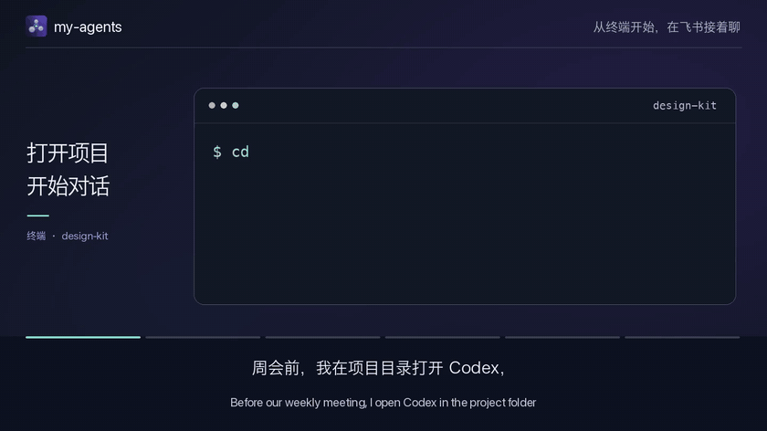
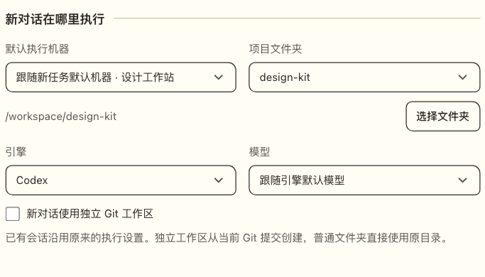
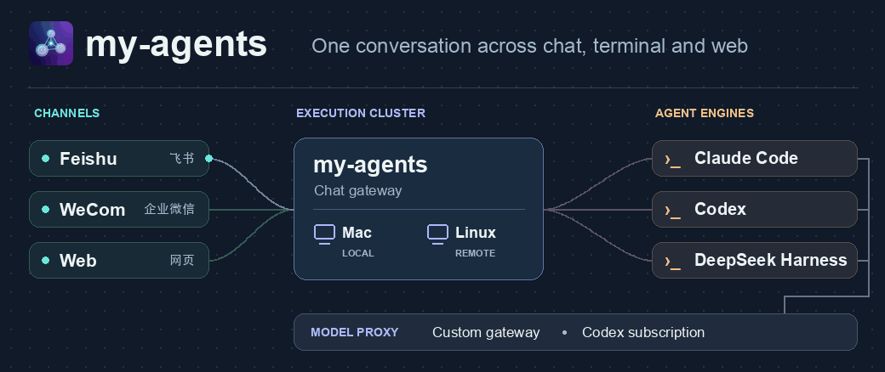

#  my-agents

**Start a coding session in your terminal, ask a follow-up from your phone, and pick up the same conversation in your browser.**

my-agents is a self-hosted panel that connects Feishu / Lark, WeCom and the web to your own Codex, Claude Code or DeepSeek Harness. Files and commands stay on the Mac or Linux machine you choose for the task.

[中文](README.md) · [Quick start](#quick-start) · [Connect a chat app](#connect-a-chat-app) · [Tour and guides](#tour-and-guides)

[](https://cdn.jsdelivr.net/gh/13days/my-agents@c649f281ab28fba819469a0ad8400c5220aa55a1/docs/session-handoff.mp4)

*Select the animation to play the 30-second narrated clip with English subtitles. The demo uses a sample project called design-kit and locally rendered Feishu cards.*

## Quick start

On a **Mac or Linux machine** with Git and curl, run the source installer to try the Sketchbook interface and WeCom settings shown here. On first install it prepares Node.js and starts the panel.

```sh
curl -fsSL https://raw.githubusercontent.com/13days/my-agents/main/install.sh | sh
```

1. Install at least one engine, such as Codex or Claude Code, on the computer that will run your tasks. Sign in or connect a model gateway you already use.
2. Open **[localhost:4321](http://localhost:4321)**. Under **Conversations → New conversation**, choose a project folder and an engine. Select **Appearance → Sketchbook** in the top-right corner for the style shown here.
3. Ask “How do I run this project?” Once you have a reply, you can resume that conversation from a chat app.

<details>
<summary>Use the npm release, or open a remote panel from your laptop</summary>

With Node.js 18+ and npm installed, run the published build below. New features arrive with npm releases.

```sh
npx --yes @wuchupeng/my-agents@latest
```

For a panel hosted on a server, run this on your laptop. Replace `user@server` with your SSH address, then open localhost on port 4321.

```sh
ssh -N -L 4321:127.0.0.1:4321 user@server
```

[Install Codex](https://developers.openai.com/codex/cli/) · [Install Claude Code](https://code.claude.com/docs/en/quickstart) · [Installation and persistent services](docs/agent-install.md)

</details>

## Connect a chat app

| App | Set it up once | Continue the work |
| --- | --- | --- |
| **Feishu / Lark** | In **Chat apps → Feishu**, scan the setup QR code or enter an existing app’s credentials. Follow the pairing steps. | DM `/sessions design-kit`, select **切换** (Switch), then ask “Expand the second point.” Use `/new` for a fresh task. |
| **WeCom** | Create an **intelligent bot**, select **API mode → Long connection**, and enter its Bot ID and Secret in the panel. Have the intended owner send the first DM, `/whoami`. | Use `/sessions keyword` to find a session, `/use 1` to select the first result and `/status` to check progress. Send text, voice or a quoted follow-up. Mention the bot in groups. |

WeCom normally lists a member’s own sessions in the current chat. To pick up terminal and web sessions, first verify the paired owner, then enable owner session access in DMs. The setup page also lets you choose a machine, directory, engine, model and optional Git worktree for new conversations. In Feishu, the task author can create a read-only share card under **Details & actions** and forward the result. [Chat app setup](docs/im-channels.md) · [Feishu commands and cards](docs/feishu-interaction.md) · [Share card animation](https://raw.githubusercontent.com/13days/my-agents/main/docs/feishu-share.gif)



Back at your desk, **⌘K** (or **Ctrl+K** on Windows and Linux) opens search. Switch projects, find an answer inside a conversation, or filter tasks by status. Press Enter to open a result. To resume from a terminal, run `codex resume <session-id>` or `claude --resume <session-id>` on the original machine. [Terminal handoff requirements](docs/user-guide.md)


## One panel for several machines

Have Claude Code review the frontend on your Mac while Codex runs tests on Linux. Each conversation has its own execution machine and project directory. Both report progress to the same panel.



- **Connect a machine.** Open **Computers & AI accounts → Computers**. Add a passwordless SSH host or alias to install the remote runner automatically. For password or MFA logins, sign in yourself and run the connection command shown in the panel.
- **Map the project.** Browse folders on each computer card. The same project can point to `~/src/design-kit` on the Mac and `/srv/repos/design-kit` on Linux. Each machine works in its own checkout.
- **Keep receiving messages.** macOS supports idle-sleep prevention and login startup. For reception when a laptop goes offline, deploy three full panels. Two online panels can elect a new message receiver. An existing CLI process stays on the machine that started it. [Project paths and worktrees](docs/execution-workspaces.md) · [Cluster setup and takeover](docs/cluster-setup.md)

## Choose the engine and the model separately

**You can use Claude Code’s tools with a GPT model.** Set up a model source under **Computers & AI accounts → AI accounts**. The engine runs commands and edits files on your computer. The account or gateway supplies the model.

| Model access you have | How to use it |
| --- | --- |
| A ChatGPT subscription that includes Codex | Sign in under **Codex**, then choose **Use Codex subscription proxy → Set up a Claude Code account**. One subscription can serve both Codex and Claude Code. |
| An Anthropic Messages-compatible gateway | Choose **Connect a custom proxy** under Claude Code, enter the gateway configuration and select an available model. DeepSeek Harness can reuse this proxy on machines with `dsh` installed. |

Set the default model for new conversations per engine. In a Feishu thread, use `/model` to select the model and `/route` to choose the account. If a gateway maps model names, check the observed model under **Details & actions** on the completed card. [Codex subscription proxy](docs/codex-subscription-proxy.md) · [DeepSeek Harness setup](docs/deepseek-harness.md)

## Let the assistant follow a conversation

Authorize your personal Feishu account under **Assistant** and select the chats to read. For example, a colleague can ask for a change in a group and clarify it later in a DM. The assistant considers the senders, follow-ups and existing tasks, then suggests which messages belong together and which session should receive them. Approve, change the destination or dismiss the suggestion. Reviews can inform later decisions.


Message sync and model analysis have separate switches. Model analysis also supports a daily budget. [Assistant access, review and budget](docs/heartflow.md)

## Tour and guides

[](https://cdn.jsdelivr.net/gh/13days/my-agents@c649f281ab28fba819469a0ad8400c5220aa55a1/docs/my-agents-intro.mp4)

**2 min 40 sec · Chinese narration · English and Chinese captions.** The tour follows a project from terminal to chat, then covers parallel tasks, model gateways and assistant approvals. [Download the MP4](https://raw.githubusercontent.com/13days/my-agents/c649f281ab28fba819469a0ad8400c5220aa55a1/docs/my-agents-intro.mp4) · [Download captions](docs/my-agents-intro.srt)

[User guide](docs/user-guide.md) · [Releases](https://github.com/13days/my-agents/releases) · [Report an issue](https://github.com/13days/my-agents/issues) · [MIT license](LICENSE)
