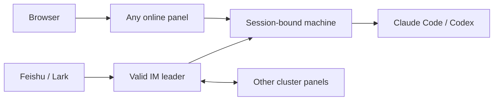

<div align="center">

# my-agents

**One workspace for your Claude Code, Codex, accounts and development machines.**

Use external coding agents from a browser or IM, with shared account routing and explicit session ownership.

[中文](README.md) · [User guide (中文)](docs/user-guide.md) · [Cluster setup (中文)](docs/cluster-setup.md) · [Agent installation protocol (中文)](docs/agent-install.md)


</div>

Open the panel on your laptop, run tasks on a development server, and check the results in Feishu or Lark. my-agents manages access to external agents; Claude Code and Codex provide the actual reasoning and tool execution.

## What you get

| Capability | How it helps |
| --- | --- |
| Unified sessions | Browse native CLI history, continue conversations, inspect timestamps, durations, tool calls and reasoning summaries exposed by the CLI |
| IM task forms | `/new your question` opens one form for machine, project, engine, model, isolated workspace and first prompt |
| Remote execution | Connect development machines over SSH or WebSocket; map a project's actual path separately on each machine |
| Shared account pools | Separate Claude Code and Codex pools for subscriptions and proxies, with automatic sign-in discovery, shared routing and failover |
| Concurrent development | Give tasks separate Git worktrees and branches |
| Request inspection | Inspect requests, responses, usage and failures to distinguish account, model and network issues |
| IM availability | Keep a majority of persistent cluster panels online so another member can take over IM reception |
| Resource management | Manage local commands, skills, agents, plugins, configuration and project activity |

A session keeps its own machine, directory and engine. Choosing another executor for a new task does not move existing conversations.

## Quick start

You need Git, Node.js ≥ 18, and a usable Claude Code or Codex installation. **The npm package is not published yet; install from source.**

```bash
git clone https://github.com/13days/my-agents.git
cd my-agents
npm install
npm start
```

Open **http://localhost:4321**. Check Machines & engines, configure your project directory, and start a new conversation. Configure and pair a bot under IM connections when you need messaging access.

There is no frontend build step. Dependency installation is still required: WebSockets use `ws`; Feishu/Lark also needs the optional official SDK. Starting the panel may configure a terminal Claude proxy wrapper. Use `MY_AGENTS_NO_PROXY_SETUP=1 npm start` for manual integration.

## Deployment choices

| Setup | Purpose | IM takeover |
| --- | --- | --- |
| Single panel | Local browsing and execution | Requires this machine to stay online |
| Panel + execution nodes | Run tasks on remote machines | Runtime nodes do not vote |
| Three full cluster panels | Continue receiving IM when a laptop goes offline | Available while a majority remains connected |



The panel you open, the IM leader, and the executor are separate roles. `node --hub` connects execution only. Follow the [cluster guide](docs/cluster-setup.md) to configure voting panels, consistent membership, persistent services and machine-specific project paths. Two full panels plus a witness is an alternative for election quorum; a witness does not replicate account state or run tasks.

## Let an Agent install it

Copy this into your coding Agent and provide the machine inventory:

```text
Install my-agents using the installation protocol at:
https://raw.githubusercontent.com/13days/my-agents/main/docs/agent-install.md
Mode: single machine / three full cluster panels.
Machines: names, SSH targets and addresses reachable by other members.
Preserve existing data and projects. Verify the running source, Git revision,
CLI versions, connectivity and session ownership. Complete automated setup
and identify any browser sign-in or bot authorization I must perform.
```

The [full installation protocol](docs/agent-install.md) can also be copied directly. It covers discovery, installation, membership distribution, services, verification and recovery. First-time account authorization may require human interaction.

## Data and limits

The panel stores its own data separately from source code. Existing installations may still use the legacy Claude directory; inspect the active service before changing data paths. See the [migration guide](docs/migration.md).

Cluster panels synchronize session bindings, bounded conversation checkpoints, relevant configuration and protected account credentials. They do not automatically copy full native histories, repositories or worktrees, or migrate running CLI processes. Subsequent turns can use a mapped project on an eligible takeover machine; unsynchronized worktrees require explicit handling.

Feishu/Lark is the implemented IM channel. Other channels require adapters. Shared accounts remain subject to upstream subscription permissions, model availability and rate limits. Use only trusted machines: access tokens, account stores and captures are sensitive, and captures can include prompts and tool results. Prefer private networks, VPNs or protected TLS connections.

## Documentation and contributions

The full manuals are currently in Chinese: [usage](docs/user-guide.md), [cluster setup](docs/cluster-setup.md), [Agent installation](docs/agent-install.md). An offline usage guide is available from the panel's lower-left navigation.

```bash
npm install
npm test
```

[Issues](https://github.com/13days/my-agents/issues) and pull requests are welcome. Include the Git revision, machine role, CLI versions and a redacted error. Never attach credentials or private captures.

[MIT License](LICENSE)
