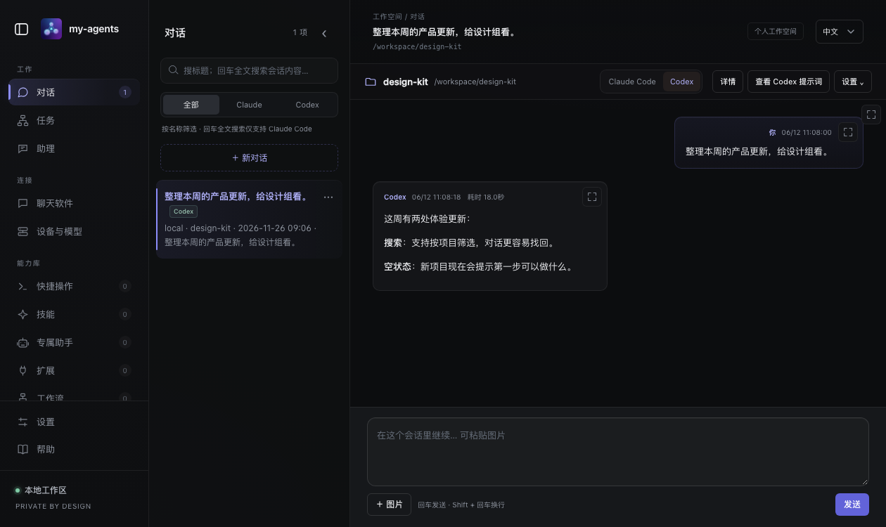

#  my-agents

在 Codex 或 Claude Code 终端开始的对话，出门后可以在飞书接着聊，回到电脑也能在网页或原终端继续。前面问过什么、改过什么，都留在同一个会话里。一个面板就能调度多台机器，也能让同一个引擎通过代理使用不同模型。

[English](README.en.md) · [使用手册](docs/user-guide.md)

[](https://cdn.jsdelivr.net/gh/13days/my-agents@bdadbb6c08c8ef17e2872f091494e7f7a53bc1bf/docs/my-agents-intro.mp4)

**[▶ 播放产品介绍](https://cdn.jsdelivr.net/gh/13days/my-agents@bdadbb6c08c8ef17e2872f091494e7f7a53bc1bf/docs/my-agents-intro.mp4)** · 58 秒 · 中文旁白 · 中英字幕 · [下载 MP4](https://raw.githubusercontent.com/13days/my-agents/main/docs/my-agents-intro.mp4)

*动图录自网关生成的飞书卡片的本地预览。下面的截图来自真实面板，使用示例账号、项目和对话。*

## 在终端、飞书和网页接着聊

1. **在终端开始。** 比如，你在项目目录里用 Codex 或 Claude Code 问「这周合入了哪些产品更新？」。两种引擎各自保存会话，后面接手的是你选中的那一条。
2. **出门后用飞书接手。** 给机器人发 `/sessions 产品更新`，按机器、项目和最近的问题找到刚才的会话，点「切换到此会话」。直接发「把第二条展开，写给设计组看」，它就能接着上文回答。
3. **回到电脑继续。** 在网页的「对话」里打开同一条记录，可以看到飞书里的追问和答复，继续改稿。也可以回到原终端接着聊。如果窗口已经关闭，在原机器的项目目录用 `codex resume <会话ID>` 或 `claude --resume <会话ID>` 恢复。

要接手仍开着的终端窗口，Codex 需要原机器的 daemon 已加载该会话，Claude Code 需要原窗口允许接收会话消息。[原终端接续说明](docs/user-guide.md)



## 从飞书里用一次

比如你要准备周会。在和机器人的私聊里发：

> /new 帮我看一下这个项目本周合入的改动，整理三条给团队看的更新。

选好项目和引擎，提交任务。完成后，卡片直接展示写好的三条更新。点卡片最底部署名行末尾的「详情与操作」，可以看工具记录和执行机器。想改口吻，直接在话题里说「改成发给设计同学的版本」。想发到周会群，任务发起人可以在已完成的任务卡上点 **详情与操作 → 生成分享卡**，确认正文后用飞书转发。转发后，收件人能在卡片底部看到本轮使用的引擎和已确认的模型，点「my-agents」就能打开这个项目。

## 启动第一台

已安装 Node.js 18+ 和 npm 的机器，可以用一条命令启动：

```sh
npx --yes @wuchupeng/my-agents@latest
```

新 Mac 或 Linux 开发机上只有 Git 和 curl？使用源码安装命令，它会在需要时自动下载并校验 Node.js 24 LTS（Intel / ARM 64 位）。

```sh
curl -fsSL https://raw.githubusercontent.com/13days/my-agents/main/install.sh | sh
```

打开 **[localhost:4321](http://localhost:4321)**。使用源码安装命令时，代码放在 `~/.local/share/my-agents/source`，面板在当前终端运行。下次可以重用同一条命令。

1. **先跑通本机。** 在要执行任务的机器上安装并登录 [Codex](https://developers.openai.com/codex/cli/) 或 [Claude Code](https://code.claude.com/docs/en/quickstart)。在「对话 → ＋ 新对话」选项目，试试「这个项目怎么启动？」。
2. **接上飞书。** 打开「聊天软件」，点「扫码创建机器人」。如果已有机器人，也可以填入应用凭证。跟随页面完成配对和卡片按钮授权。
3. **发第一条任务。** 私聊机器人，发送上面的 `/new` 示例。执行进度和结果都会回到飞书。 [飞书卡片与命令](docs/feishu-interaction.md)

在「聊天软件 → 飞书 → 访问权限」，可以直接看到谁能私聊、哪些群需要单独授权。图中林舟已配对，可以在机器人加入的任意多人群直接 @ 它。设计协作群单独勾选后，小榆也能在该群使用。


<details>
<summary>已经有开发环境，想从源码运行</summary>

```sh
git clone https://github.com/13days/my-agents.git
cd my-agents
npm install
MY_AGENTS_NO_PROXY_SETUP=1 npm start
```

安装脚本和这条启动命令都保留现有终端代理配置。要让服务在登录后常驻，可在 macOS 面板里启用登录自启，Linux 使用用户服务。 [安装与常驻](docs/agent-install.md)

</details>

## 一个终端启动，多台机器分头工作

在「设备与模型 → 机器 → 添加机器」填入平时使用的免密 SSH 地址，例如 `devbox`。面板会检查环境、准备运行时、安装执行程序并建立连接。设备显示「已连接」后，在「项目与目录」填写项目在那台机器上的真实路径。下一次新建对话就能选它。


SSH 连不进去，但开发机能访问面板时，展开「其他接入方式」，复制接入命令到开发机运行即可。

比如，你想让笔记本上的 Claude Code 检查前端，同时让 Linux 开发机上的 Codex 跑测试。打开两个对话，各选自己的机器和项目目录，就可以在同一个面板看两边的进度。

在飞书里，发 `/node` 查看在线机器。假设开发机名为 `devbox`、项目已在 `~/repos/web`，发 `/node devbox ~/repos/web`，然后在同一话题发「跑一下项目的测试」。命令和文件操作都会在开发机的这份代码上执行。

只需要远程执行时，加执行节点就够了。如果希望笔记本关机后飞书机器人仍在线，可以部署三台常驻完整面板。主面板离线时，其余两台形成多数派，其中一台接管后续消息。 [集群搭建与接管](docs/cluster-setup.md)

## 同一个引擎，按任务选模型

Claude Code 或 Codex 负责读文件、跑命令和维护会话。回答问题的模型由账号和代理提供。比如，日常修改可以用响应快的模型，遇到复杂排查，再在同一飞书话题换一个擅长推理的模型。

1. **接入模型。** 打开「设备与模型 → 引擎与账号」，选择 Claude Code 或 Codex，添加订阅或代理账号。在「新会话默认模型」里，从该引擎可用的列表选择默认值。两个引擎分别设置。
2. **给当前会话换模型。** 在飞书话题发 `/model`，从列表选一个，下一轮生效。发 `/model default` 恢复默认。任务结束后，展开「详情与操作」查看本轮记录到的实际模型和代理。若代理设置了固定模型映射，最终模型由该规则决定。
3. **在 Claude Code 里用 Codex 订阅。** 在 Codex 账号池打开「Claude Code 使用订阅代理」，按提示把配置放入独立的 Claude 配置目录。此后 Claude Code 仍在选定机器执行工具，模型请求交给 Codex 订阅池。 [配置示例和支持范围](docs/codex-subscription-proxy.md)


## 让助理替你留意消息

在「助理」里连接个人飞书账号，选择读取范围，开启同步。助理会汇总相关私聊和群聊，结合发送人、后续回复和已有任务，建议哪些消息适合一起交给哪个会话。你可以调整归属、忽略或确认执行。确认记录能给下次判断作参考。


消息同步和模型分析分别有开关，模型分析可以设置每日预算。 [助理设置与审批](docs/heartflow.md)

## 项目

[报告问题](https://github.com/13days/my-agents/issues) · [MIT 许可证](LICENSE)
