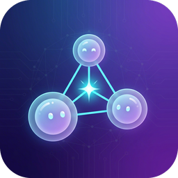
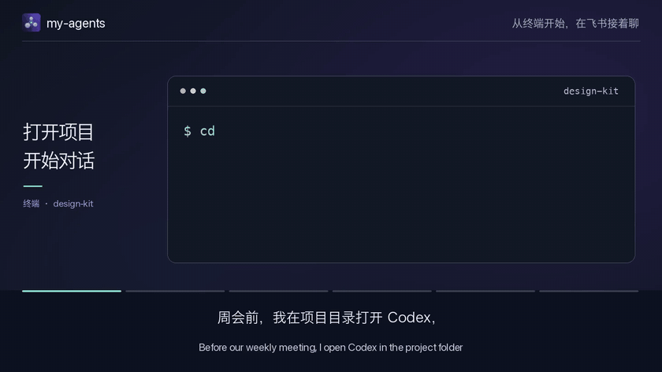
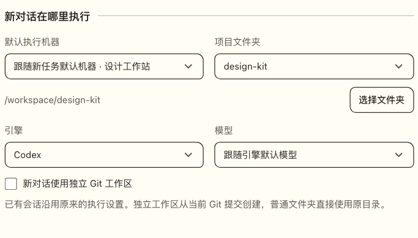
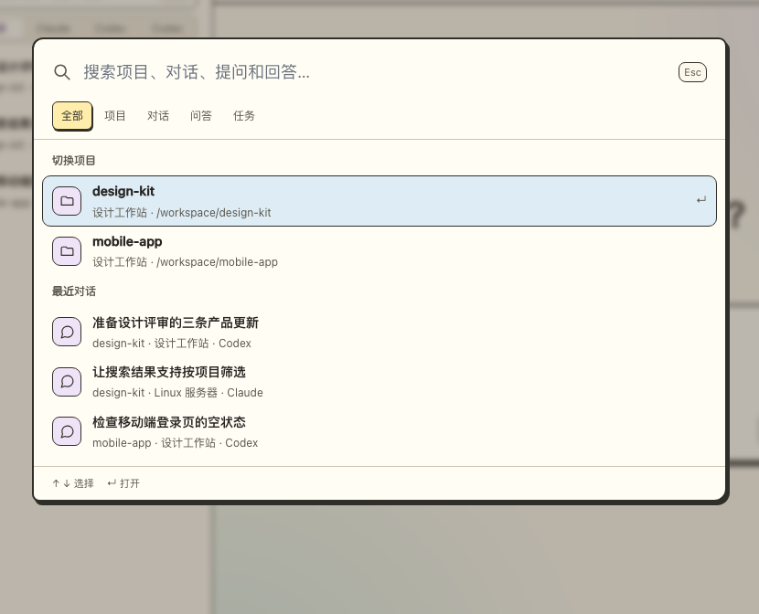
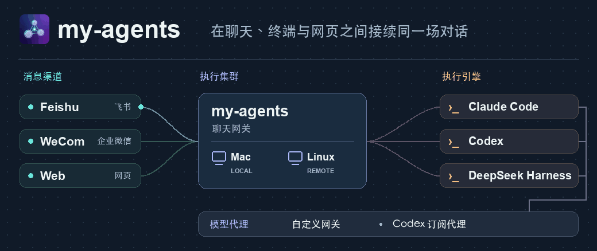

#  my-agents

**终端里的 Codex 或 Claude Code，出门后能从飞书、企业微信接着问，回到网页还能看到同一条对话。**

my-agents 是一个自托管的 AI 编程工作台。你可以从同一面板给 Mac 和 Linux 服务器分配任务，也可以让 Claude Code 使用已有的 Codex 订阅或模型网关。引擎还支持 DeepSeek Harness。

[English](README.en.md) · [接入聊天软件](#接入聊天软件) · [账号和模型代理](#用已有账号选择引擎和模型) · [看完整演示](#完整演示与文档)

## 快速开始

在一台装有 **Git 和 curl 的 Mac 或 Linux 电脑** 上运行。安装脚本会检查 Node.js，按需安装，然后启动面板。

```sh
curl -fsSL https://raw.githubusercontent.com/13days/my-agents/main/install.sh | sh
```

1. 在要执行任务的电脑上装好 [Codex](https://developers.openai.com/codex/cli/) 或 [Claude Code](https://code.claude.com/docs/en/quickstart)，登录账号或配置已有的模型网关。
2. 打开 **[localhost:4321](http://localhost:4321)**，点「对话 → 新对话」，选引擎和一个 Git 项目。试着发「把最近几次提交整理成三条更新」，三条更新会出现在这条对话里。
3. 想从手机接手，就按下方步骤连接聊天软件。下方动图演示了如何在手机上找到 `design-kit` 的原会话，追问其中的第二条。

[](https://cdn.jsdelivr.net/gh/13days/my-agents@c649f281ab28fba819469a0ad8400c5220aa55a1/docs/session-handoff.mp4)

*点击动图播放 30 秒有声短片，含中英字幕。示例使用手绘纸张主题和本地生成的飞书卡片预览。在面板右上角的「外观」可切换到同款主题。*

### npm 或远程访问

- **用 npm 安装。** 已有 Node.js 18+ 和 npm，可运行 `npx --yes @wuchupeng/my-agents@latest`。本页截图跟随 GitHub 主分支。[查看 npm 发布版](https://www.npmjs.com/package/@wuchupeng/my-agents)
- **从笔记本访问服务器。** 在笔记本执行下面的命令，把 `user@server` 换成你的 SSH 地址，再打开本机的 4321 端口。[安装与开机常驻](docs/agent-install.md)

```sh
ssh -N -L 4321:127.0.0.1:4321 user@server
```

## 接入聊天软件

### 飞书 / Lark

1. 打开「聊天软件 → 飞书」，扫码创建机器人，或填入已有应用的凭据，按页面提示配对。
2. 私聊机器人发 `/sessions design-kit`，把 `design-kit` 换成你的项目名。点结果右侧的「切换」，就可以追问「把第二条展开，举个例子」。要另开对话，发 `/new`。
3. 要把结果发给同事，在自己的完成卡中展开「详情与操作」，生成只读分享卡后转发。[飞书卡片和命令](docs/feishu-interaction.md) · [分享卡动图](https://raw.githubusercontent.com/13days/my-agents/main/docs/feishu-share.gif)

### 企业微信

1. 创建智能机器人，选择「API 模式 → 长连接」，在「聊天软件 → 企业微信」填入 Bot ID 和 Secret。等面板显示「已连接」，由希望担任 Owner 的成员先私聊发 `/whoami`。
2. 想接手终端或网页的会话，先在接入页开启「允许已配对的 Owner 在私聊中查找并接手面板和终端会话」。然后私聊发 `/sessions design-kit`，用 `/use 1` 选择第一条，再发追问。默认设置下，成员看到的是自己在当前聊天里的会话。
3. 新开对话可在同一页设置执行机器、文件夹、引擎、模型和独立 Git 工作区。发 `/status` 查看进度，也可以发语音、引用消息或在群里 @机器人。[企业微信接入与权限](docs/im-channels.md)



### 回到网页或终端

回到网页，按 **⌘K**（Windows / Linux 用 **Ctrl+K**）即可切换项目、搜到一条历史回答，或按状态找到失败的任务。回车直接进入对应会话。回到原机器的终端，也可以用 `codex resume <会话ID>` 或 `claude --resume <会话ID>` 接着做。[原终端接续条件](docs/user-guide.md)



## 一个面板，多台机器

例如，同时让 Mac 上的 Claude Code 检查前端，让 Linux 上的 Codex 跑测试。两个对话分别使用各自的机器和代码目录，进度都能在同一个面板看到。



- **添加执行机器**　打开「电脑与 AI 账号 → 连接电脑」。免密 SSH 可以直接添加主机别名，远端无需预装 my-agents。需要密码或验证码时，先自行登录，再运行页面生成的接入命令。
- **选对目录**　在机器卡片里浏览文件夹。一个项目可以在 Mac 上映射到 `~/src/design-kit`，在 Linux 上映射到 `/srv/repos/design-kit`。各台电脑使用自己的代码副本。
- **让机器人持续在线**　Mac 可设置防闲置睡眠和登录自启。需要笔记本关机后仍能接单，可部署三台完整面板。两台保持在线即可选出新的消息接收节点，已启动的 CLI 进程仍属于原机器。[目录与独立工作区](docs/execution-workspaces.md) · [集群部署与接管](docs/cluster-setup.md)

## 用已有账号选择引擎和模型

**喜欢 Claude Code 的工具，也可以让它调用 GPT。** 在「电脑与 AI 账号 → AI 账号」配置下表中的任一来源。读写文件、跑命令的是执行机器上的引擎，回答问题的模型由账号或网关提供。

| 你已有的模型来源 | 能怎么用 |
| --- | --- |
| 带 Codex 权限的 ChatGPT 订阅 | 在 Codex 下登录订阅，再点「使用 Codex 订阅代理 → 填入 Claude Code 账号」。同一个订阅可以用于 Codex 和 Claude Code。 |
| 兼容 Anthropic Messages 的网关 | 在 Claude Code 下点「连接自定义代理」，填入网关配置并选可用模型。已接入的代理也能用于安装了 `dsh` 的 DeepSeek Harness。 |

可以分别设置新对话的默认模型。飞书话题用 `/model` 选模型，`/route` 选账号。网关存在固定映射时，可在完成卡的「详情与操作」核对本轮实际记录的模型。[Codex 订阅代理](docs/codex-subscription-proxy.md) · [DeepSeek Harness 接入](docs/deepseek-harness.md)

## 让助理留意飞书里的后续

在「助理」单独授权个人飞书账号并选择聊天范围。比如，同事在群里提了需求，又在私聊里补充细节，助理会结合发送人、后续回复和已有任务，建议把相关消息一起交给正在做这件事的会话。你可以确认、改选会话或忽略建议，核对记录会参与后续判断。


页面可分别关闭消息同步和模型分析，也可以为模型分析设每日预算。[助理的读取范围、审批与预算](docs/heartflow.md)

## 完整演示与文档

[](https://cdn.jsdelivr.net/gh/13days/my-agents@c649f281ab28fba819469a0ad8400c5220aa55a1/docs/my-agents-intro.mp4)

**2 分 40 秒 · 中文旁白 · 中英字幕**　从终端接手、转发结果，到多机执行、模型网关和助理审批。[下载 MP4](https://raw.githubusercontent.com/13days/my-agents/c649f281ab28fba819469a0ad8400c5220aa55a1/docs/my-agents-intro.mp4) · [下载字幕](docs/my-agents-intro.srt)

[使用手册](docs/user-guide.md) · [版本更新](https://github.com/13days/my-agents/releases) · [反馈问题](https://github.com/13days/my-agents/issues) · [MIT 许可证](LICENSE)
