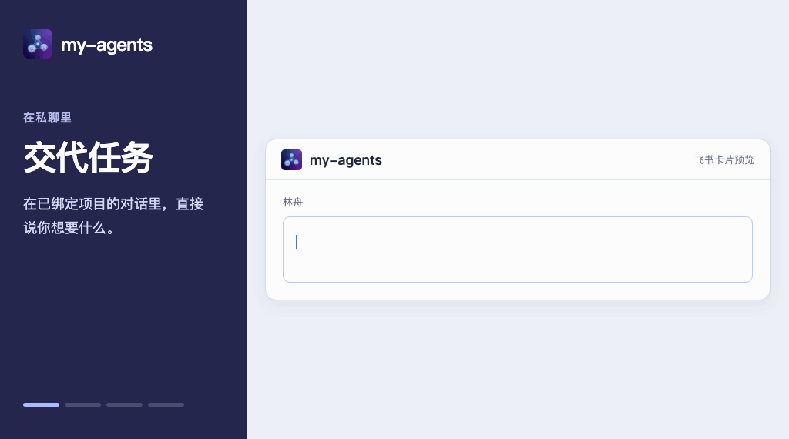
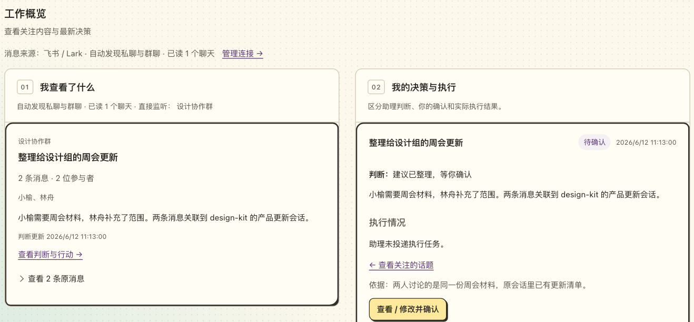
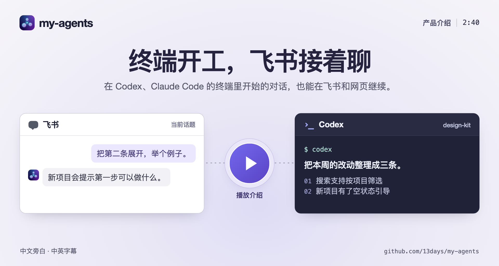

#  my-agents

**在终端里用 Codex 或 Claude Code 开始工作，出门后用飞书追问，回到网页接着做。三个入口共享同一条会话。**

在装好 Node.js 18+ 和 npm 的 Mac 或 Linux 电脑上运行

```sh
npx --yes @wuchupeng/my-agents@latest
```

打开 **[localhost:4321](http://localhost:4321)**，选择已登录的引擎，发第一条消息。要合上笔记本后继续执行，可以把面板和会话放在常开的 Linux 服务器上。如果面板装在远端，在自己电脑上运行 `ssh -L 4321:127.0.0.1:4321 user@server`（换成你的 SSH 地址），再打开上面的网页。

[连接飞书](#从飞书里用一次) · [连接企业微信](#用企业微信发任务) · [多机执行](#一个终端启动多台机器分头工作) · [使用手册](docs/user-guide.md) · [English](README.en.md)

[](https://github.com/13days/my-agents/releases/download/v0.18.1/my-agents-handoff.mp4)

[播放 24 秒演示（中文旁白 · 中英字幕）](https://github.com/13days/my-agents/releases/download/v0.18.1/my-agents-handoff.mp4)。画面使用示例项目 design-kit。

## 在终端、飞书和网页接着聊

1. **在终端开始。** 比如，你在项目目录里用 Codex 或 Claude Code 问「这周合入了哪些产品更新？」。两种引擎各自保存会话，后面接手的是你选中的那一条。
2. **出门后用飞书接手。** 给机器人发 `/sessions 产品更新`，按机器、项目和最近的问题找到刚才的会话，点行尾「切换」。需要核对分支或历史时展开「会话详情」。接着发「把第二条展开，写给设计组看」，它就能接着上文回答。
3. **回到电脑继续。** 在网页的「对话」里打开同一条记录，可以看到飞书里的追问和答复，继续改稿。也可以回到原终端接着聊。如果窗口已经关闭，在原机器的项目目录用 `codex resume <会话ID>` 或 `claude --resume <会话ID>` 恢复。


要接手仍开着的终端窗口，Codex 需要原机器的 daemon 已加载该会话，Claude Code 需要原窗口允许接收会话消息。[原终端接续说明](docs/user-guide.md)


## 从飞书里用一次

比如你要准备周会。在和机器人的私聊里发：

> /new 帮我看一下这个项目本周合入的改动，整理三条给团队看的更新。

发送 `/help` 可以直接点「找会话」或「新建任务」，也能按场景查命令。选好项目和引擎，提交任务。完成后，卡片直接展示写好的三条更新。点卡片最底部署名行末尾的「详情与操作」，可以看工具记录和执行机器。想改口吻，直接在话题里说「改成发给设计同学的版本」。想发到周会群，任务发起人可以在已完成的任务卡上点 **详情与操作 → 生成分享卡**，确认正文后用飞书转发。转发后，收件人能在卡片底部看到本轮使用的引擎和已确认的模型，点「my-agents」就能打开这个项目。



*飞书动图录自网关生成的卡片预览，面板截图使用示例账号、项目和对话。*

## 启动第一台

新 Mac 或 Linux 服务器上只有 Git 和 curl？使用源码安装命令，它会在需要时自动下载并校验 Node.js 24 LTS（Intel / ARM 64 位）。

```sh
curl -fsSL https://raw.githubusercontent.com/13days/my-agents/main/install.sh | sh
```

打开 **[localhost:4321](http://localhost:4321)**。使用源码安装命令时，代码放在 `~/.local/share/my-agents/source`，面板在当前终端运行。下次可以重用同一条命令。

1. **先跑通本机。** 在执行任务的机器上安装 Codex 或 Claude Code。有对应账号可以直接登录，使用 Claude Code 的人也可以接入下面的两种代理。在「对话」里直接问「这个项目怎么启动？」。输入框上方可以更换目录和执行机器。 [Codex 安装](https://developers.openai.com/codex/cli/) · [Claude Code 安装](https://code.claude.com/docs/en/quickstart)
2. **接上飞书。** 打开「聊天软件」，点「扫码创建机器人」。如果已有机器人，也可以填入应用凭证。跟随页面完成配对和卡片按钮授权。
3. **发第一条任务。** 私聊机器人，发送上面的 `/new` 示例。执行进度和结果都会回到飞书。 [飞书卡片与命令](docs/feishu-interaction.md)

在「聊天软件 → 飞书 → 访问权限」，可以直接看到谁能私聊、哪些群需要单独授权。图中林舟已配对，可以在机器人加入的任意多人群直接 @ 它。设计协作群单独勾选后，小榆也能在该群使用。


### 在 DeepSeek Harness 复用已有代理

新建对话时选择 **DeepSeek Harness**，在执行机器上使用已安装的 `dsh`。可以选择 Claude Code 账号池里的代理和模型，后续消息继续同一个 Harness 会话。独立运行的 Harness 网页也能接入。在 my-agents 的 **电脑与 AI 账号 → AI 账号 → DeepSeek Harness** 展开连接设置，复制本机代理地址和专用代理密钥。在 Harness 的 **设置 → 模型 → 自定义模型 API** 里选择 **Anthropic Messages**，添加面板显示的模型 ID。 [接入与运行要求](docs/deepseek-harness.md)

### 用企业微信发任务

1. 在企业微信创建**智能机器人**，选择 **API 模式 → 长连接**，取得 Bot ID 和 Secret。
2. 打开 **聊天软件 → 企业微信**，填入凭据，选择新对话使用的引擎和项目，点「保存并连接」。面板只需要能向外连接企业微信。
3. 首位给机器人发消息的成员自动成为 Owner，可以直接执行任务。其他成员可私聊获取 UserID，由面板管理员添加。获授权成员可以私聊或在群里 @机器人发送文字任务。结果回到原聊天，也能在网页「对话」查看。对同一聊天发下一条会续接，单独发 `/new` 后再发任务可另起一轮对话。

安装时自动检查并补装 `lark-cli` 和 `wecom-cli`。企业微信的成员名单与飞书独立。飞书的分享卡片和助理读取个人聊天仍通过飞书配置。 [企业微信接入说明](docs/im-channels.md)


<details>
<summary>已经有开发环境，想从源码运行</summary>

```sh
git clone https://github.com/13days/my-agents.git
cd my-agents
npm install
MY_AGENTS_NO_PROXY_SETUP=1 npm start
```

安装脚本和这条启动命令都保留现有终端代理配置。要让服务在登录后常驻，可在 macOS 面板里启用登录自启，Linux 使用用户服务。 [安装与常驻](docs/agent-install.md)

</details>

## 一个终端启动，多台机器分头工作


在「电脑与 AI 账号 → 连接电脑 → 添加电脑」填入平时使用的免密 SSH 地址，例如 `linux-server`。面板会检查环境、准备运行时、安装执行程序并建立连接。在同页选择「新任务默认执行机器」。点电脑卡片上的「选择目录」浏览本机或远程文件夹。在卡片内的「项目文件夹」点「添加」，可新建项目或为已有项目关联这台电脑上的目录。已有会话沿用其执行机器。


远端无需预装 my-agents。SSH 需要密码或验证码时，用你平时的方式登录远程电脑，选同一页的「在远端终端接入」，把命令粘贴到远端运行，并保留该进程。远程电脑需要能访问面板的内网地址。如果面板只监听本机，页面会提示如何开启内网监听。两种方式都需要在执行机器上准备对应的引擎 CLI 和可用账号。

比如，你想让笔记本上的 Claude Code 检查前端，同时让 Linux 服务器上的 Codex 跑测试。打开两个对话，各选自己的机器和项目目录，就可以在同一个面板看两边的进度。

在飞书里，发 `/node` 查看在线机器。假设服务器名为 `linux-server`、项目已在 `~/repos/web`，发 `/node linux-server ~/repos/web`，然后在同一话题发「跑一下项目的测试」。命令和文件操作都会在服务器的这份代码上执行。

如果希望 Mac 待机时继续接单，可以在飞书连接的「运行与启动设置」开启保活，避免空闲休眠。

只需要远程执行时，加执行节点就够了。如果希望笔记本关机后飞书机器人仍在线，可以部署三台常驻完整面板。主面板离线时，其余两台形成多数派，其中一台接管后续消息。 [集群搭建与接管](docs/cluster-setup.md)

## 没有 Claude 模型，也能用 Claude Code

打开 **电脑与 AI 账号 → AI 账号 → Claude Code**，按你手上已有的账号选一种。两种方式都由 Claude Code 在所选电脑上读写项目文件、运行命令。

| 你手上有什么 | 怎么接入 |
| --- | --- |
| 兼容 Anthropic Messages API 的网关 | 点 **连接自定义代理**。粘贴网关提供的 Claude Code 配置，或手动填地址和 Token。保存后可在账号的「选择模型」里查看网关提供的模型。 |
| 带 Codex 权限的 ChatGPT 订阅 | 在 **AI 账号 → Codex → 添加账号 → 登录订阅账号** 完成登录。已有订阅账号可直接点 **使用 Codex 订阅代理 → 填入 Claude Code 账号**，核对模型并保存。Claude Code 就可以调用订阅提供的 GPT。 |

在面板里将保存的账号设为首选，或在飞书话题发 `/route` 查看并选择账号。想在自己的终端用同一订阅，订阅代理窗口也提供独立的 Claude Code 配置和启动命令。 [终端配置与支持范围](docs/codex-subscription-proxy.md)


Claude Code 和 Codex 可以分别设置「新对话默认模型」。要为当前飞书话题换模型，发 `/model` 选择，下一轮生效。发 `/model default` 恢复默认。若网关固定了模型映射，最终调用以该映射为准。完成后可在卡片「详情与操作」查看本轮实际记录的模型和代理。

## 让助理替你留意消息

在「助理」里连接个人飞书账号，选择读取范围，开启同步。助理会汇总相关私聊和群聊，结合发送人、后续回复和已有任务，建议哪些消息适合一起交给哪个会话。你可以调整归属、忽略或确认执行。确认记录能给下次判断作参考。



消息同步和模型分析分别有开关，模型分析可以设置每日预算。 [助理设置与审批](docs/heartflow.md)

## 完整产品介绍

[](https://cdn.jsdelivr.net/gh/13days/my-agents@v0.18.1/docs/my-agents-intro.mp4)

2 分 40 秒了解会话接续、多机执行、Codex 订阅代理和飞书助理。[下载视频](https://raw.githubusercontent.com/13days/my-agents/v0.18.1/docs/my-agents-intro.mp4) · [中英字幕](docs/my-agents-intro.srt)

## 项目

如果你也在终端和聊天软件之间切换，欢迎给 [my-agents](https://github.com/13days/my-agents) 点个 Star。遇到接续失败，可以在 Issue 里写下你从哪个入口切到了哪个入口。

[查看版本更新](https://github.com/13days/my-agents/releases) · [报告问题](https://github.com/13days/my-agents/issues) · [MIT 许可证](LICENSE)
