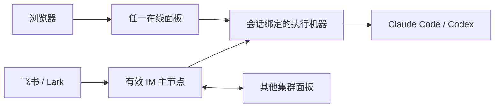

<div align="center">

# my-agents

**一个工作空间，连接你的 Claude Code、Codex 和开发机。**

在浏览器或 IM 中使用外部 Agent，统一管理会话、账号、项目和执行机器。

[English](README.en.md) · [使用手册](docs/user-guide.md) · [集群搭建](docs/cluster-setup.md) · [交给 Agent 安装](docs/agent-install.md)


</div>

my-agents 让你在 Mac 上打开面板，在开发机运行任务，在飞书里查看结果。它负责连接和管理外部 Agent；实际的代码理解、工具执行和模型能力来自 Claude Code / Codex。

适合同时使用多个订阅账号、在多台机器开发，或希望离开电脑后仍能通过 IM 继续工作的人。

## 能做什么

| 场景 | 使用方式 |
| --- | --- |
| 统一会话 | 查看原生 CLI 历史，在网页继续对话，查看时间、耗时、工具执行和引擎公开的推理摘要 |
| 随时发起任务 | 飞书 / Lark 中用 `/new 问题` 打开表单，一次选择机器、项目、引擎、模型和独立工作区 |
| 多机协作 | 远程执行节点通过 SSH 或 WebSocket 接入；项目在每台机器上分别配置真实路径 |
| 账号池 | Claude Code 与 Codex 各自一个账号池，均支持订阅与代理；正常登录后自动收录，支持轮询、故障切换与跨机共享 |
| 并发开发 | 用 Git worktree 为任务创建独立分支与目录，避免多个 Agent 同时修改同一个工作区 |
| 请求排障 | 查看请求与响应、耗时、用量和失败记录，区分账号、网络和模型问题 |
| IM 接管 | 多个常驻面板组成多数派集群，选举 IM 主节点；Mac 关闭后，在线成员仍可接收消息 |
| 资源管理 | 管理命令、技能、Agent 配置、插件和 MCP 等本机资源，回顾项目活动 |

已有会话绑定自己的执行机器、目录和引擎。新建任务选择另一台机器，不会把旧会话一起改过去。

## 五分钟启动

需要 Git、Node.js ≥ 18，以及可用的 Claude Code 或 Codex。**npm 包尚未发布，当前从源码安装。**

```bash
git clone https://github.com/13days/my-agents.git
cd my-agents
npm install
npm start
```

打开 **http://localhost:4321**，然后：

1. 在「机器与引擎」检查 CLI 与账号接入。
2. 在「项目与目录」设置本机项目路径。
3. 从「会话 → 新对话」发送第一条任务。
4. 需要 IM 时，在「IM 接入」配置机器人并完成配对。

源码无需前端构建。`npm install` 仍然必需：WebSocket 使用 `ws`，飞书 / Lark 还需要可选的官方 SDK；若安装时跳过了可选依赖，请在启用 IM 前补齐。

首次启动可能为终端配置 Claude 请求代理。希望手动管理接入时，可用 `MY_AGENTS_NO_PROXY_SETUP=1 npm start`。配置和数据目录详见[使用手册](docs/user-guide.md)。

## 选择适合你的部署

| 部署方式 | 适合 | 能否接管 IM |
| --- | --- | --- |
| 单机面板 | 本机浏览与执行 | 该机器在线时可用 |
| 面板 + 执行节点 | 将任务放到远程开发机 | 执行节点不参与选举 |
| 三台完整集群面板 | Mac 离线后仍可从 IM 工作 | 保持多数派时可选举新主节点 |



浏览器访问哪台机器、哪台机器接收 IM、任务在哪台机器执行，是三个不同的选择。普通 `node --hub` 命令只加入执行通道；要参与主节点接管，需按[集群搭建手册](docs/cluster-setup.md)部署完整面板。

## 让 Agent 帮你安装

把下面这段交给你正在使用的编码 Agent，并补上机器信息：

```text
请安装并配置 my-agents。
先读取 https://raw.githubusercontent.com/13days/my-agents/main/docs/agent-install.md，按其中的安装协议执行。
部署模式：单机 / 三台完整面板集群（选择一种）。
机器：填写机器名称、SSH 目标、其他成员可访问的地址；单机可直接探测本机。
已有数据和项目必须保留；确认实际运行来源、Git 提交、CLI 版本、节点连通和会话绑定。
完成可执行的安装工作，列出仍需我完成的浏览器登录或机器人授权。
```

也可以直接复制[完整 Agent 安装手册](docs/agent-install.md)全文。手册包含探测、安装、集群分发、常驻服务、验收和回滚步骤；账号首次授权仍可能需要你在浏览器操作。

## 使用与维护

- [完整使用手册](docs/user-guide.md)：账号池、模型、IM、目录映射、worktree、备份与排障。
- [集群搭建与升级](docs/cluster-setup.md)：三节点部署、成员配置、常驻运行和接管验证。
- [Agent 安装协议](docs/agent-install.md)：可直接交给 Agent 执行的完整说明。
- [执行位置与工作区](docs/execution-workspaces.md)、[数据迁移](docs/migration.md)、[IM 扩展设计](docs/im-channels.md)、[架构说明](docs/architecture-v2.md)。

页面左下角的「使用指南」也可以离线阅读。

## 使用边界

当前内置 IM 实现为飞书 / Lark；企业微信等渠道尚需适配。账号共享适用于你有权使用的账号与可信机器，受上游订阅权限、模型可用性和限流约束。账号池不会扩大订阅配额。

集群同步会话绑定、有限对话检查点及相应配置与受保护的账号凭证；**不会自动同步整个原生 CLI 历史、仓库文件或 worktree，也不会迁移正在运行的进程**。执行机器离线后，后续轮次可按已配置的项目映射接续；存在未同步工作区时需要明确处理。两台机器无法同时实现严格多数派和任意单机离线后的自动接管。

面板、节点接入令牌、账号库和抓包记录都应只交给可信用户。抓包可能包含任务内容与工具结果。跨机器访问优先使用可信内网、VPN 或受保护的 TLS 通道，不直接暴露公网端口。

## 参与开发

```bash
npm install
npm test
```

欢迎提交 [Issue](https://github.com/13days/my-agents/issues) 或 Pull Request。报告问题时附上 Git 提交、运行机器、引擎版本与脱敏错误；不要上传令牌、账号凭证或完整私人抓包。

[MIT License](LICENSE)
