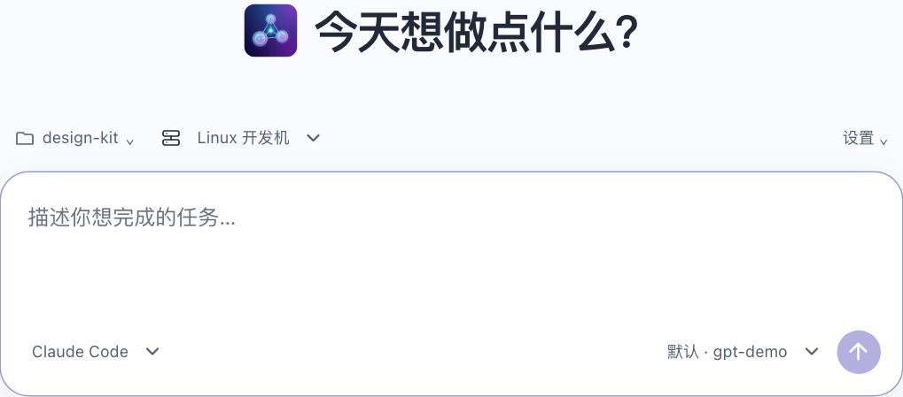
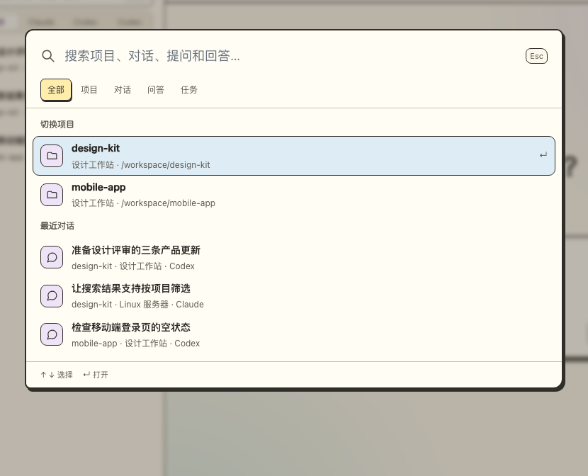
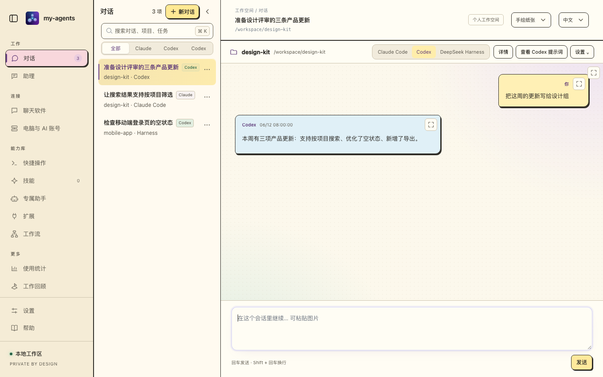

# my-agents 使用手册

[返回首页](../README.md) · [集群搭建](cluster-setup.md) · [Agent 安装协议](agent-install.md)

在终端运行 `my-agents help` 可查看启动、后台服务和节点命令，以及网页帮助与聊天软件的入口。

## 1. 理解三个位置

- **当前面板**：浏览器访问的服务。换一个面板地址，不代表迁移了任务。
- **IM 主节点**：持有有效多数派租约、接收机器人消息的面板。主节点可以接管，执行机器可以保持不变。
- **执行机器**：拥有项目、原生 CLI 会话和工作目录，实际启动 Claude Code / Codex 的机器。

会话保存自己的机器、项目路径与引擎。`/new` 选择其他机器只影响新任务；旧卡片应按原会话查找。缺少旧记录时先检查原机器连接，不要通过删除历史“修复”。

## 2. 安装与首次启动

准备 Git、Node.js ≥ 18。源码安装不需要前端构建：

```bash
git clone https://github.com/13days/my-agents.git
cd my-agents
npm install
npm start
```

打开 `http://localhost:4321`。已安装 Node.js 18+ 的机器也可以用 `npx --yes @wuchupeng/my-agents@latest` 启动。

在自己的 npm 可写安装前缀中安装或更新外部 CLI：

```bash
npm install --global @openai/codex@latest @anthropic-ai/claude-code@latest
codex --version
claude --version
```

若报权限问题，先检查 `npm prefix --global` 与 shell PATH，选用自己的可写前缀；不要覆盖系统或其他工具管理的安装。通过 CLI 的正常登录流程完成授权，或在「电脑与 AI 账号 → AI 账号」配置支持的代理账号。上游浏览器授权可能需要本人操作。

检查 `command -v codex`、`command -v claude` 与服务使用的 PATH；终端升级成功不代表后台进程已经使用了新 CLI。`CODEX_CLI`、`CLAUDE_CLI` 可以显式指定安装路径；升级后在空闲时重启服务。

### 数据目录

| 内容 | 默认位置 / 规则 |
| --- | --- |
| 面板数据 | 显式 `MY_AGENTS_HOME` 优先；否则使用已存在的 `~/.my-agents`；再否则兼容原 Claude 数据目录 |
| Claude 原生历史 | `CLAUDE_DIR`，通常为 `~/.claude` |
| Codex 原生数据 | `CODEX_HOME`，通常为 `~/.codex` |
| 源码 | Git 仓库所在目录，与以上数据目录不同 |
| 项目与 worktree | 各执行机器的项目目录与独立工作目录 |

**升级老环境时先查运行服务的环境变量和实际数据位置。** 不要直接设置一个空的 `MY_AGENTS_HOME`，然后误以为历史丢失。面板数据迁移命令会复制文件并保留原件，详见[迁移说明](migration.md)。备份不仅要包含面板数据，还要包含各机器原生历史和未提交的项目文件。

### 常用启动参数

```bash
# 新环境：明确面板数据目录，仅在本机监听
MY_AGENTS_HOME="$HOME/.my-agents" MY_AGENTS_NO_PROXY_SETUP=1 node server.js

# 可信内网接入：允许远程连接
MY_AGENTS_HOME="$HOME/.my-agents" MY_AGENTS_BIND=0.0.0.0 node server.js
```

默认网页端口 `4321`，本机代理端口 `4322`。监听地址 `0.0.0.0` 不是给其他成员填写的目标地址：成员应使用能实际访问的主机名或 IP。

首次运行可能为终端设置 Claude 代理包装；不希望自动改 shell 时设置 `MY_AGENTS_NO_PROXY_SETUP=1`。代理仅在面板运行时提供服务。需要移除终端集成可从源码运行 `node server.js uninstall-proxy`。

## 3. 机器、目录与独立工作区

在「电脑与 AI 账号 → 连接电脑」检查三项状态：面板通信、Agent 执行通道、IM 接收。面板连通不等于 CLI 已安装、账号有效或项目已准备。

### 添加执行节点

在「电脑与 AI 账号 → 连接电脑 → 添加电脑」选择接入方式。免密 SSH 可以使用本机 SSH 配置中的主机别名，面板会准备 Node.js、安装远端执行器并验证连接。SSH 需要密码或验证码时，先自行登录远端，再运行「在远端终端接入」生成的命令，并保留运行进程。该方式需要远端能通过内网访问面板。两种方式都无需预装 my-agents，运行任务需要相应的引擎 CLI 与账号。

普通执行节点不投票、不接管 IM。需要 Mac 断电后继续接收机器人消息，请部署[完整面板集群](cluster-setup.md)。

### 设置项目映射

打开「电脑与 AI 账号 → 连接电脑」。顶部可设置新任务默认执行机器；线上已有的会话沿用原机器。

1. 在电脑卡片上点「选择目录」，浏览该电脑并选定默认文件夹。
2. 在这台电脑的卡片内，点「项目文件夹 → 添加」新建项目，例如 `demo-server`。
3. 用「浏览」选择目录，也可粘贴路径。在另一台电脑的卡片中点「添加」并选择已有项目，分别设置目录，例如 Mac `/Users/alex/src/demo-server`、Linux `/home/alex/src/demo-server`。
4. 保存时会到目标机器校验目录。要修改名称、路径或解除这台电脑的映射，点项目旁的「编辑」。移除映射会保留磁盘文件。

映射不会复制文件、拉取仓库或同步未提交修改。默认目录用于新任务；已有会话仍使用原项目目录。不要把 Mac 的 `/Users/...` 路径作为 Linux 的工作目录。

### 并发任务用 worktree

新会话选择独立工作区后，从当前 Git 提交创建任务分支与目录。原工作区的未提交修改、未跟踪文件和依赖不会自动带入。每个工作区占用检出的文件与自身产物，Git 对象库共享；实际磁盘取决于项目、依赖和构建产物。

合并或归档前检查分支与 `git status`。清理时使用 `git worktree list` 确认所有权和使用情况；保留有改动、未合并提交或仍被会话引用的工作区，不要直接批量删除目录。

## 4. 会话、模型和账号池

打开「对话」即可在中央输入框开始任务。输入框上方可更换执行机器、浏览项目目录，下方可切换引擎和模型。「设置」里可以选择独立工作区和代理账号。会话列表支持筛选和历史查看。时间、工具执行与推理摘要来自引擎事件。



「电脑与 AI 账号 → AI 账号」中，Claude Code 与 Codex 各自有独立账号池。每个池都支持订阅账号和代理 / API 账号，页面使用同一套状态检查、命名、启停、移除和路由操作；切换引擎不会混入另一个引擎的账号。

**订阅账号完成官方登录后自动入池，不需要再点击导入。** 新增第二个账号时，点击对应引擎池的「新增订阅账号」，复制生成的独立目录登录命令，到任一已接入且运行中的机器执行。不要先退出默认账号，也不要在正在使用的默认登录目录直接换号。

例如，新增一个 Codex 账号：

```bash
my_agents_login_dir="${CODEX_HOME:-$HOME/.codex}/my-agents-logins/second-account"
mkdir -p -m 700 "$my_agents_login_dir"
CODEX_HOME="$my_agents_login_dir" codex -c 'cli_auth_credentials_store="file"' login
```

新增 Claude Code 账号同样使用独立目录：

```bash
my_agents_login_dir="${CLAUDE_CONFIG_DIR:-$HOME/.claude}/my-agents-logins/second-account"
mkdir -p -m 700 "$my_agents_login_dir"
CLAUDE_CONFIG_DIR="$my_agents_login_dir" claude auth login
```

页面每次生成不同的目录名；上例名称仅作示意，不要重复拿同一个目录切换多个账号。独立目录用于新增登录，后续可继续从面板和 IM 使用账号池，不必修改现有会话的目录。

Codex CLI 与扩展会共用登录缓存；在同一目录退出或换号，可能让正在运行的旧 CLI 无法刷新。用 `CODEX_HOME` 隔离新增登录可避免覆盖默认缓存，参见 [官方认证说明](https://learn.chatgpt.com/docs/auth?surface=cli) 与 [配置目录说明](https://learn.chatgpt.com/docs/config-file/config-advanced)。账号池保留条目不代表被上游撤销的授权仍有效；显示 401 / 需要重新授权时，点击该条目的「重新授权」，在独立目录登录原账号。

后台定期检查默认目录及上述独立登录目录，自动加入对应账号池并加密同步到集群。页面在账号页空闲时自动更新，也可点「刷新」。切换登录账号会保留池内旧条目；重复身份去重。已停用或移除的条目不会被后台重新启用，显式「导入登录文件」可恢复。撤销上游授权或退出登录可能使旧凭证失效，账号池不能延长被撤销的授权。

Claude 原生凭证从 macOS 钥匙串或对应配置目录的 `.credentials.json` 发现；Codex 从 `CODEX_HOME/auth.json` 发现。自定义 Claude 登录目录应与面板 / 节点的 `CLAUDE_CONFIG_DIR` 一致。原生登录方法见 [Claude Code 官方认证说明](https://code.claude.com/docs/en/authentication)。

使用自定义网关时，在「电脑与 AI 账号 → AI 账号 → Claude Code」点「连接自定义代理」。网关需要支持 Anthropic Messages API。粘贴 Claude Code 的 env 配置，或填写网关地址和 Token，保存后可在账号的「选择模型」里选用网关提供的模型。若希望独立启动的终端 Claude Code 也用这个账号，在同一页的「终端 Claude 接入与抓包」点击「一键配置」，再重新启动 Claude Code。

Codex 自定义网关从「Codex → 添加账号 → 代理 / API 账号」接入，地址应为兼容 OpenAI Responses API 的端点，通常以 `/v1` 结尾。

- **自动故障切换**：优先选定账号，符合条件的失败再选择可用账号。
- **轮询**：新选择在可用账号间轮转；会话尽量保持账号稳定。
- **手动选择**：明确指定会话使用的账号；仍受有效期和上游权限限制。

完整集群面板同步受保护的账号凭证。已接入的执行节点可以加密上报本机已有登录；执行任务时使用面板提供的受限代理凭证，无须每台机器重新登录同一个订阅。仅在原机器运行的本地桥接代理仍依赖该桥接服务在线。关闭 Codex 代理接入、改走原生直连时，需要执行机器自身具备对应登录。

模型下拉框取决于当前引擎与账号。Codex 的默认模型从账号实时可见模型目录中选择；手填模型 ID 优先，但上游可能拒绝。账号池汇集已有权限，不增加模型权限或订阅配额。不要将过时模型名写死在所有机器配置中。

DeepSeek Harness 对话可共用 Claude Code 账号池。独立 Harness 网页可在「AI 账号 → DeepSeek Harness」取得 Provider ID、代理地址、协议和模型。 [DeepSeek Harness 接入](deepseek-harness.md)

### Claude 代理账号的模型列表

在 Claude 代理账号卡片点击「选择模型」，可从该账号的实时目录选择固定模型，也可刷新目录。选择会写入 `modelMap["*"]`，覆盖客户端 `/model`，更具体的精确 ID / 家族映射仍优先；「不固定」只移除 `*`，不会删除高级映射。目录查询失败不会清空已保存的模型，未保存或停用的账号须先保存 / 启用。

### Claude Code 底部代理状态

仓库内 `scripts/proxy-statusline.py` 可用作 Claude Code 的 `statusLine.command`（`python3 -I <仓库绝对路径>/scripts/proxy-statusline.py`）。本机默认端口为面板 4321、代理 4322；macOS 的 `io.my-agents.gateway.plist` 可提供实际端口。

状态栏区分客户端模型与代理实际发送模型：有本会话请求证据时显示代理、发送模型和结果，Codex 桥接还显示实际订阅账号；没有证据时仅显示配置目标和「待捕获」。代理不可达时明确降级，不引用其他会话请求。显示的是发往上游的模型 ID / 别名，不推断供应商内部模型。接口为 `GET /api/proxy/statusline?sessionId=<Claude UUID>`，只返回路由摘要，不返回凭证和对话正文。

## 5. 接入飞书 / Lark

飞书和 Lark 支持以下飞书命令与卡片。企业微信通过智能机器人长连接支持文字、语音和引用消息，首位发消息的成员成为 Owner。发 `/sessions` 找回会话，`/use 1` 切换，`/status` 查看进度。网页可查看最近 30 条收信与回执、添加成员，为新对话选择执行机器、目录、引擎、模型和独立 Git 工作区。 [企业微信接入说明](im-channels.md)

1. 在开放平台创建企业自建应用，启用机器人，取得 App ID 和 App Secret。
2. 授予机器人发送消息、接收私聊消息的权限；需要群内使用时增加群聊 @ 消息权限。
3. 订阅消息接收与卡片操作事件，启用长连接方式，并完成应用发布 / 可用范围配置。
4. 在「IM 接入」选择飞书或 Lark，填写凭证并启用。
5. 生成一次性配对码，用自己的账号私聊机器人发送 `/pair 配对码`，再测试命令。

常用事件为 `im.message.receive_v1`、`card.action.trigger`；常用权限包括 `im:message:send_as_bot`、`im:message.p2p_msg:readonly`，群内 @ 使用 `im:message.group_at_msg:readonly`。附件与反应功能还可能需要资源读取和消息反应权限，以开放平台及页面提示为准。

群里通过 `@机器人` 使用；不同话题分别绑定上下文。允许使用机器人的用户可以发起 Agent 工具操作，配对与授权应只开放给可信用户。

| 命令 | 用途 |
| --- | --- |
| `/new 问题` | 打开新任务表单；问题预填且可编辑，选完统一提交 |
| `/sessions 关键词` | 筛选会话，展开用户消息，查看轮次与时间并切换 |
| `/current` | 查看当前绑定、执行位置与操作入口 |
| `/history` | 查看当前会话最近已保存的对话 |
| `/engine`、`/claude`、`/codex` | 查看 / 切换引擎，分别接续上下文 |
| `/model` | 查看模型并选择下一轮使用的模型 |
| `/node` | 查看 / 手动切换执行位置 |
| `/route` | 查看账号接入与路由状态 |
| `/switch 序号`、`/rename 新名称` | 切换到列表中的会话，或为当前会话命名 |
| `/queue 内容`、`/steer 内容`、`/stop` | 排队、补充当前要求、停止任务或断开与原终端的同步 |
| `/ask 内容` | 将以斜杠开头的内容作为问题交给引擎 |
| `/model global`、`/use 引擎` | 调整共享默认模型，或切换当前引擎 |
| `/reply wide`、`/reply card`、`/reply markdown` | 按聊天保存回复格式 |
| `/status`、`/leader` | 查看运行或集群状态 |
| `/help` | 打开「找会话」「新建任务」和分组命令。简洁群、Markdown 模式使用文字版 |

表单提交失败应保留选择和首条问题，按原因修改后重新提交。点击旧卡片只查询或切换它所指的会话；不会沿用最近一次 `/new` 的执行机器。

Claude Code 原窗口与飞书来回接续：发送 `/sessions 关键词`，按会话名称、项目、分支和用户消息确认后切换，直接发送问题。检测到原来打开的交互式 Claude Code 窗口及原生消息入口时，IM 会直接连接这个进程，不再启动第二个 CLI 进程。终端先聊、飞书继续、再回终端时，始终由原窗口处理，新增消息和回答都进入它的内存上下文与会话记录；原窗口保持打开即可，无需手动重新载入。原窗口正在执行时，IM 消息先等待当前一轮结束再送入。

原窗口接续沿用该窗口现有的模型、登录和工具权限。原生入口需要支持会话消息通道的 Claude Code；原窗口可能把跨会话消息暂存等待接收授权，尤其在原窗口跳过工具权限提示时。此时 IM 显示「等待原窗口确认」，需要在原窗口批准；IM 会持续跟踪，批准后的回答仍会同步回来。超过 30 秒仍未确认时显示「投递待确认」，不会报运行失败、另建会话或自动重发。离开电脑前请先用一条消息验证原窗口允许接收。接收策略由原窗口的 `/config` → Messages from your other sessions 控制（[Claude Code 官方说明](https://code.claude.com/docs/en/cross-session-messaging#control-inbound-messages)）；my-agents 不会自动修改它。窗口退出会明确说明。点击「断开 IM 同步」或发送 `/stop` 只断开 IM 跟踪，不关闭原窗口，也不终止它正在执行的操作。暂时只支持文字通过原窗口通道发送。关闭原窗口后仍可按原会话历史续接，但不能把这种方式当作打开中的窗口实时同步。

## 6. 接管的实际行为

IM 主节点离线时，有多数派的集群可以选出新主节点，重新连接机器人。已有会话的执行机器仍保持原绑定。

执行机器离线时，下一轮可尝试转到有效 IM 主节点，并通过同一逻辑项目的路径映射接续。接续使用有限对话检查点，可能生成新的原生会话 ID。未同步的 worktree 需要手动处理；没有目录映射时会说明原因，不会自动把异机绝对路径拿来运行。

页面和 IM 都保留手动选择能力。不会无条件重跑断线前的命令；对于“是否已提交 / 发布 / 编译完成”等问题，先检查实际产物或日志。

## 7. 运行保障、升级和备份

Linux 常驻服务：

```bash
node server.js service install --home "$MY_AGENTS_HOME" --bind 0.0.0.0
node server.js service status
```

仅限需要远程访问时使用外网监听。服务捕获安装时 PATH；更新路径后要重新生成配置，并在空闲时重启。macOS 使用「IM 接入」中的运行保障 / 登录自动启动；睡眠、断网、关机会影响本机任务，集群不替代机器自身的运行条件。

升级所有面板前记录每台 Git SHA、实际程序路径、数据目录和 CLI 版本。工作区有其他人的未提交修改时保留，禁止强制重置；仅快进到同一个已验证提交。升级磁盘代码之后，等待面板任务与外部代理请求全部空闲，再逐台重启 / 重连，保留多数派。

备份面板数据目录、集群配置与加密账号库、原生 CLI 历史、项目仓库、worktree 和服务配置。备份文件按私密凭证保存；只保留加密账号库而丢失相关密钥配置可能无法恢复。恢复时先停止对应服务，核对目录与权限，避免覆盖更新的数据。

## 8. 常见问题

### 原 Codex 终端、网页和飞书之间接续

在会话列表选择原机器上的同一条 Codex 会话。原会话由该机器已经运行的 Codex daemon 加载时，网页和飞书通过本机 daemon 的消息队列接入，使用相同的 thread ID；沿用原终端的模型、账号与权限。终端正在执行时，新消息排队，当前执行继续。回复通过原会话记录同步，回到原 Codex 窗口可以接着聊。

网页打开 Claude Code 或 Codex 会话后，会持续读取原会话的新对话。CLI 中继续发送的问题、回答和工具记录无需刷新网页即可显示；网页已有回复在流式输出时优先保持实时连接，空闲后再与原生记录核对。跟随更新只替换对话内容，不清空正在输入的草稿，不自动滚动离开用户正在查看的位置，也不会新建 CLI 进程。选中文本、放大内容或加载更早历史时暂缓更新。

接入前可在原机器运行 `codex app-server daemon version` 检查 daemon；需要支持 `thread/queue/add` 和 `thread/turns/list` 的版本。面板不会自动启动、重启 daemon 或修改原会话权限。daemon 不可用、原会话被其他写入器占用时，会提示检查原机器，本次不会自动复制会话。尚未加载的历史会话仍使用普通续接路径，不表示另一个已打开窗口已接入。

网页的「断开同步」与飞书的「断开飞书同步」只断开面板观察，不会停止原终端，也不会撤回已经投递的消息。权限确认仍由原入口处理。连接中断后通过消息 ID 核对结果，不自动重发；只有对应原生 turn 明确结束，才显示完成。上游 `response.completed` 之前断流表示上游回复未完整结束，应等待原 Codex 的重连结果，不要连续重复提交同一问题。

之前版本可能已经复制了会话；已有的副本会保留。需要继续原窗口时，请在列表选择原会话，而不是副本。

| 现象 | 优先检查 |
| --- | --- |
| `localhost:4321` 拒绝连接 | 本机服务是否启动、端口是否正确；远程主节点在线不意味着本机网页服务在线 |
| 节点连接但任务失败 | 执行通道、CLI 实际路径 / 版本、账号和工作目录分别检查 |
| 工作目录不存在 | 会话原机器和项目映射；不要将 Mac 路径直接传给 Linux |
| 未登录、401 / 403 | 当前引擎是否走共享池、账号有效性、上游权限或桥接状态；连接令牌不是模型账号 |
| 模型不支持 | 刷新账号模型列表，检查手填 ID、旧会话设置与原生 CLI 配置 |
| 旧卡片查不到会话 | 原执行机器是否在线、稳定机器 ID 是否改变、原生历史是否仍在；先尝试恢复连接与 `/sessions` |
| 卡片一直等待 / 思考 | 实际引擎状态、代理请求、运行节点和网关日志；网关重启不等于命令未执行 |
| 集群没有主节点 | 多数派是否连通、成员表是否完全一致、时间与网络是否稳定 |

完整排障时记录 Git SHA、面板地址、IM 主节点、执行机器和脱敏错误，不发送原始 token、账号 JSON 或私人抓包。


### Claude Code 使用 Codex 订阅

在「AI 账号 → Codex」登录带 Codex 权限的 ChatGPT 订阅，然后在 Claude Code 账号页点「使用 Codex 订阅代理」。选择「填入 Claude Code 账号」并保存后，可为面板和飞书任务选择它。使用独立终端时，选择「复制配置」并按弹窗里的命令启动。可用 GPT 模型与额度来自订阅，文件和工具操作仍由 Claude Code 在所选机器上完成。 [配置与支持范围](codex-subscription-proxy.md)

### 从终端会话接到 IM

`/session` 或 `/sessions` 会实时汇总各台已连接机器上的原生会话，和面板使用同一份目录。终端新产生、尚未进入共享检查点的会话也能找到。运行中的会话优先，其余按最近活动排序；离线机器保留已知记录并提示读取失败。

卡片顶部可以直接搜索，也可以发送 `/sessions 关键词`。支持终端会话名称、项目、工作区路径、Git 分支、机器、会话 ID 和最近一条问题；多个关键词用空格分开。列表每行显示名称、机器、引擎、项目和最近活动，点行尾「切换」继续。展开「会话详情」查看分支、创建时间、目录和用户消息。

选择「切换」只绑定原会话，保留原执行机器和工作目录；也可以用 `/switch 会话ID前缀` 精确选择。切换不会创建新会话或自动发送任务。终端正在输出时，等本轮结束再从 IM 发下一条消息，避免两个入口同时操作同一会话。

## 产品导航

在「对话」继续交流或搜索项目、问答与任务。打开搜索的「任务」页签可按执行状态筛选。助理的建议和待确认事项在「助理」处理。

「连接」统一进入消息渠道、执行设备和模型服务，并衔接助理关注范围。当前支持飞书 / Lark 和企业微信。助理读取个人飞书消息需要单独授权。

「能力库」集中进入快捷操作、技能、专属助手、扩展与工作流，Claude / Codex 选择放在能力库及对应资源页面。「设置」提供偏好与指令；请求诊断（原抓包）、使用统计、工作回顾收进高级工具。旧页面地址继续可用。

### 页面切换与对话恢复

设置页的工具与记录入口常驻展示。当前浏览器页面内保留最近 8 个已打开对话的视图；切换对话或从其他页面返回时立即恢复草稿、附件控件和阅读位置，再后台核对最新消息。不会因为切换页面重新发送任务。该缓存只保存在内存中，刷新浏览器或关闭页面后不保留。

### 展开的侧栏分组

- 切换执行位置后，同一对话的几段记录会合成一行。点击标题继续最新一段，点击「接续记录」可以按分支查看原来的消息。
- 在对话列表点「··· → 置顶」把常用会话移到当前筛选结果顶部，同一集群会同步置顶。再次点「取消置顶」恢复原排序。
- 点击对话里的网页链接，或点输入框旁的地球图标输入网址。关掉预览或切走会话时会释放网页。限制嵌入的网站可点「打开原网页」。
- 工作区包含「对话」和「助理」。点对话列表上方的搜索按钮，或按 `⌘K`（Windows / Linux 用 `Ctrl+K`），可以切换项目、搜问答、查任务进度。方向键选择，回车打开，Esc 返回。选中项目后可以直接新建对话，输入框会使用该项目的目录。旧 `/tasks` 和 `/today` 链接会打开搜索中的「任务」。
- 连接：聊天软件、电脑与 AI 账号。聊天软件用于接入 IM、接收通知和通过聊天控制任务。
- 能力库：快捷操作、技能、专属助手、扩展、工作流。
- 更多：使用统计、工作回顾、诊断工具。
- 底部：设置、帮助。

各分组默认展开，直接点击具体功能即可进入。资源工具不兼容时会选择支持该能力的工具，选择结果显示在资源页面；不再把入口隐藏掉。

在右上角的外观选择器中可选「跟随系统」「浅色」「深色」或「手绘纸张」。选择会保存在当前浏览器。




